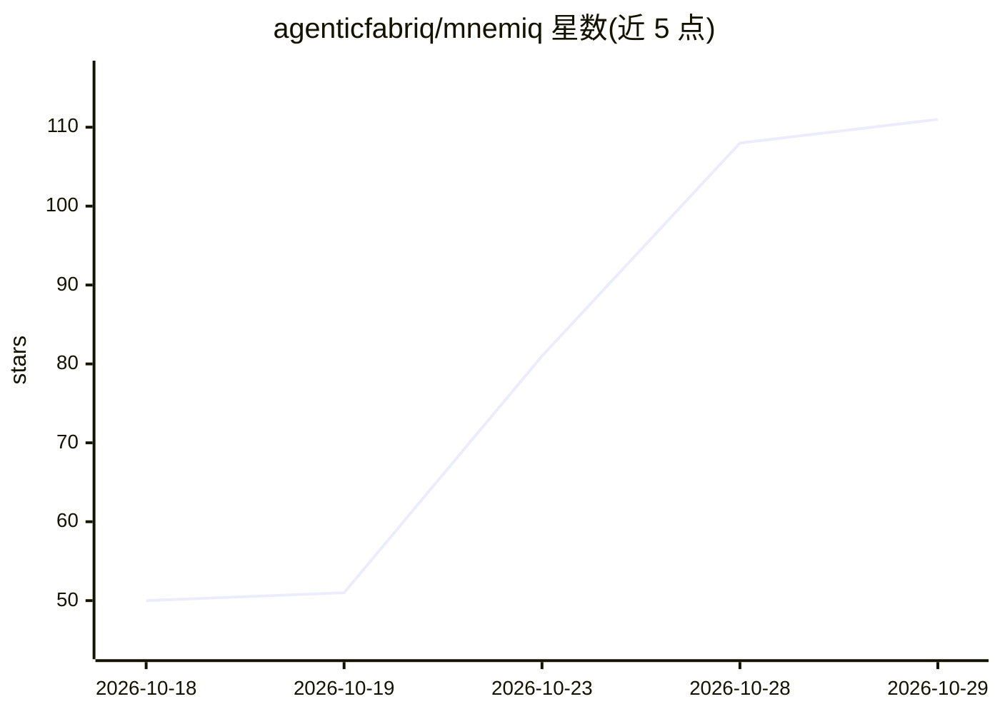

# agenticfabriq/mnemiq

⭐ 111 · Python · Apache-2.0 · 推送 2026-10-28 · [GitHub](https://github.com/agenticfabriq/mnemiq) · [官网](https://www.agenticfabriq.com/mnemiq) · 组织维护

**可在自有数据库上调参与评测的开源 text-to-SQL 引擎**

面向需要在自有数据库上回答自然语言问题的场景：模型提出 SQL，确定性裁决层在执行前校验只读、权限、方言编译与 EXPLAIN，不通过则给出带理由的拒绝；答案附带 SQL、所读表与审计 trace。流水线各阶段（模型选择、schema 检索量、语义分层 enrichment、拒绝阈值）均为可读可改的设置。内置评测 harness，按返回数据评分并分别报告正确/拒绝/错误；评分由独立仓库 beacon 承担。支持任意 OpenAI 兼容端点（vLLM/Ollama/llama.cpp 等），Apache-2.0。

## 筛选速览

| 维度 | 判定 | 备注 |
|---|---|---|
| AI 角色 | `ai-native` | 本体是模型或模型工具 |
| 许可风险 | `permissive` | Apache-2.0 |
| 部署形态 | `library` | 以包/库形式分发 |
| 模型依赖 | local-ok | 支持本地模型 |
| 硬件要求 | — | 无带数字的原话,不猜 |
| 安装摩擦 | `low` | 无编译、无系统依赖或容器化 |
| 成熟度 | — | 结构信号不足 |

## 能力要点

- 模型提议 SQL + 确定性裁决层（只读/权限/方言/EXPLAIN 校验，失败即拒绝）
- 流水线阶段作为可调设置：模型选择、schema 检索、语义 enrichment 分层（Tier 0-2）、拒绝阈值
- 内置评测 harness：按返回数据评分，正确/拒绝/错误分开报告，支持 BIRD/Spider 基准
- 评分器 beacon 独立仓库，同一评分器也用于 Snowflake Cortex Analyst 与 Databricks Genie 对比

## 适用场景

- 在自有数据库上跑问题集，测出该库上的真实正确率与拒绝率
- 让分析角色用自然语言查数，且答案可溯源到 SQL 与表
- 在本地/内网 LLM 端点上运行 NL2SQL 而不出网

## 场景标签

`数据分析` `模型评测` · 领域:效率与自动化

## 证据(README 行号)

> L7: An open-source engine that answers natural-language questions over your database, built so that
> L46: mnemiq separates writing SQL from deciding to run it. A model proposes a query. A deterministic
> L103: The evaluation harness is part of the engine, not a separate research project. It runs a question

## 星数曲线

2026-10-18 50 → 2026-10-29 111（+61）

---
*卡片 v1 · prompt 1.4 · 生成 2026-10-24 · 置信度 mid · 依据 README sha `5768d227a26a` · [字段定义](../../DATASET.md)*
