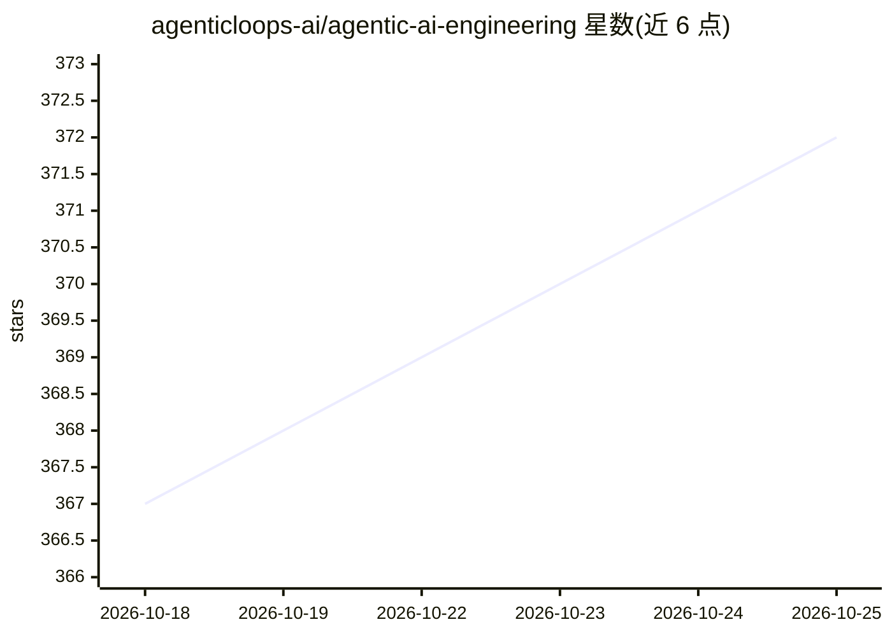

# agenticloops-ai/agentic-ai-engineering

⭐ 371 · Python · MIT · 推送 2026-10-16 · [GitHub](https://github.com/agenticloops-ai/agentic-ai-engineering) · [官网](http://agenticloops.ai) · 组织维护 · 中文 README

**从零构建 AI agent 的实操教程库，覆盖 LLM 调用到评测**

面向工程师的动手教程仓库：从第一次 LLM API 调用起步，逐步从零实现 agent loop、工具执行器、记忆层与评测框架，再进入编排模式、上下文工程、安全护栏、MCP 集成及多框架对比等 7 个模块，每模块含生产级 capstone 项目。教程用 uv 一条命令运行，需自备 Anthropic/OpenAI API key；部分模块标注 coming soon。配套 Substack 文章拆解 Claude Code、GitHub Copilot 等真实 agent 的实现机制。MIT 许可。

## 筛选速览

| 维度 | 判定 | 备注 |
|---|---|---|
| AI 角色 | `ai-knowledge` | 知识聚合/清单类 |
| 许可风险 | `permissive` | MIT |
| 部署形态 | `None` |  |
| 模型依赖 | locked-api |  |
| 硬件要求 | — | 无带数字的原话,不猜 |
| 安装摩擦 | `low` | 无编译、无系统依赖或容器化 |
| 成熟度 | — | 结构信号不足 |

## 能力要点

- 从零实现 agent loop、工具执行器、记忆层与 eval harness，先于引入任何框架
- 7 个渐进模块：基础、模式、进阶技术、测试评测、loop 工程、框架对比、生产化
- 每条教程自包含幂等，`uv run --directory` 一条命令运行
- 配套拆解 Claude Code / GitHub Copilot / OpenCode 的逆向系列文章

## 适用场景

- 系统学习 AI agent 从基础到生产的完整工程路径
- 面试前掌握工具调用与推理循环等 agent 基础原理
- 动手复现真实生产 agent 的模式与机制

## 场景标签

`教程课程` · 领域:学习与行业

## 证据(README 行号)

> L23: - 🔁 **The whole path** — from your first LLM call to a production eval harness
> L33: - 📦 **First principles, no black boxes.** You build the agent loop, the tool executor, the memory layer, the eval h

## 星数曲线

2026-10-18 367 → 2026-10-25 372（+5）

---
*卡片 v1 · prompt 1.4 · 生成 2026-10-21 · 置信度 high · 依据 README sha `3f6f03f5fff1` · [字段定义](../../DATASET.md)*
