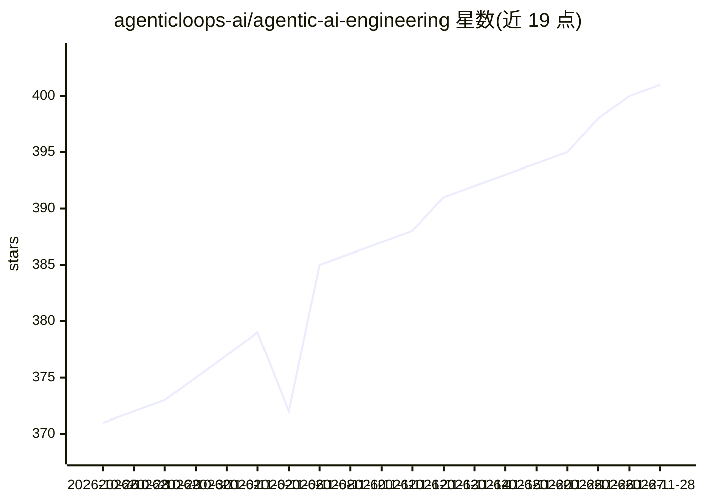

# agenticloops-ai/agentic-ai-engineering

⭐ 401 · Python · MIT · 推送 2026-11-05 · [GitHub](https://github.com/agenticloops-ai/agentic-ai-engineering) · [官网](http://agenticloops.ai) · 组织维护

**工程师从零构建 AI Agent 的实战教程集**

面向无 AI/ML 背景的工程师的 Agent 构建教程仓库：从单次 LLM API 调用、提示工程、工具调用到自主 Agent 循环，逐模块覆盖 Anthropic「Building Effective Agents」中的架构模式（链式/路由/并行/编排器-工作者等）、上下文工程、成本优化、RAG、评测与红队测试，后续模块将对比 LangGraph、CrewAI、AutoGen 等框架的同一实现。每个教程为自包含 Python 脚本，用 uv 一条命令运行；需自备 Anthropic/OpenAI API key。

## 筛选速览

| 维度 | 判定 | 备注 |
|---|---|---|
| AI 角色 | `ai-knowledge` | 知识聚合/清单类 |
| 许可风险 | `permissive` | MIT |
| 部署形态 | `None` |  |
| 模型依赖 | locked-api |  |
| 硬件要求 | — | 无带数字的原话,不猜 |
| 安装摩擦 | `low` | 无编译、无系统依赖或容器化 |
| 成熟度 | — | 结构信号不足 |

## 能力要点

- 从零构建 Agent 循环、工具执行器、记忆层与评测工具，再引入框架
- 7 个模块覆盖基础、模式、高级技术、测试评测、生产部署
- 每个教程自包含，uv run 一条命令即可运行，支持 Codespaces
- 配套 Substack 系列拆解 Claude Code、GitHub Copilot 等生产 Agent

## 适用场景

- 系统学习 LLM API 调用、提示工程与工具调用的底层机制
- 面试前准备 Agent 基础概念（工具调用、推理循环）
- 为团队搭建 Agent 评测与回归测试流程
- 按模块递进学习从原型到生产级 Agent 的工程实践

## 场景标签

`教程课程` · 领域:学习与行业

## 证据(README 行号)

> L16: # Agentic AI Engineering
> L23: - 🔁 **The whole path** — from your first LLM call to a production eval harness
> L71: ### 🎓 01 - Foundations new

## 星数曲线

2026-10-26 371 → 2026-11-28 401（+30）

---
*卡片 v1 · prompt 1.4 · 生成 2026-11-25 · 置信度 high · 依据 README sha `2a924d6a7e55` · [字段定义](../../DATASET.md)*
