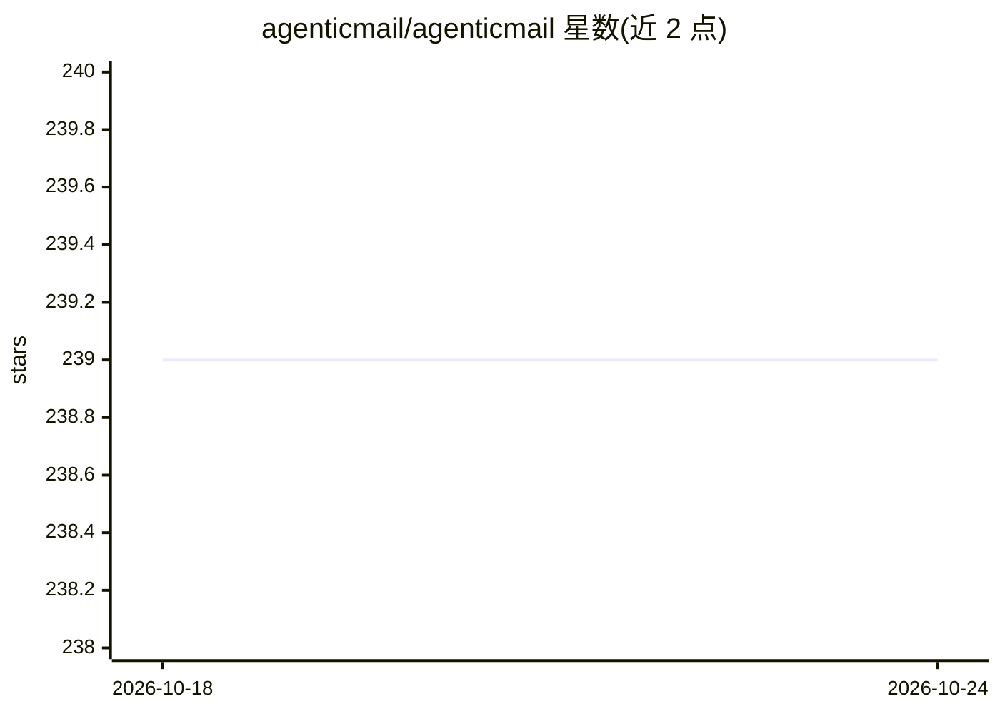

# agenticmail/agenticmail

⭐ 239 · TypeScript · MIT · 推送 2026-10-21 · [GitHub](https://github.com/agenticmail/agenticmail) · [官网](https://www.npmjs.com/package/agenticmail) · 组织维护

**给 AI agent 提供真实邮箱、手机号与通话的通信基础设施**

面向 AI agent 的通信平台：为每个 agent 分配可收发邮件、短信与验证码的真实邮箱和电话号码，并支持 agent 驱动的外呼语音通话。机制上提供 dispatcher 唤醒系统（分层唤醒上下文、唤醒合并、ThreadCache）、持久化 agent 记忆（BM25F 检索、置信度衰减）、46elks 与 Twilio 双电话运营商、OpenAI Realtime 语音桥接、Telegram 通道及 MCP 工具集（73 个）。以 npm CLI 安装，面向 Claude Code 等 agent 运行时集成。媒体工具集标注为 unreleased，部分语音路径需操作者冒烟测试。

## 筛选速览

| 维度 | 判定 | 备注 |
|---|---|---|
| AI 角色 | `ai-ecosystem` | LLM/agent 周边工具 |
| 许可风险 | `permissive` | MIT |
| 部署形态 | `self-host` | docker 或自建部署 |
| 模型依赖 | locked-api |  |
| 硬件要求 | — | 无带数字的原话,不猜 |
| 安装摩擦 | `low` | 无编译、无系统依赖或容器化 |
| 成熟度 | — | 结构信号不足 |

## 能力要点

- 为 agent 分配真实邮箱/电话号码，收发邮件、短信、验证码
- 46elks 与 Twilio 双电话运营商，OpenAI Realtime 实时语音桥接
- 分层唤醒上下文与唤醒合并机制控制多 agent 邮件线程成本
- 持久化 agent 记忆（9 类、BM25F 检索、置信度衰减）与 MCP 工具集

## 适用场景

- 让 Claude Code 等 agent 通过真实邮箱/短信与人或其他 agent 通信
- 构建可接打电话、通话中调用工具并支持人工介入的语音 agent
- 为 MCP 客户端的 agent 附加持久记忆与外部通信能力

## 场景标签

`Agent 记忆` `语音 Agent` `Agent 框架` · 领域:Agent 开发

## 证据(README 行号)

> L7: **The first platform to give AI agents real email addresses and phone numbers.** Send and receive email, SMS, and ve
> L11: > Your human asked you to install / set up AgenticMail. **Pick either of these and then tell them to restart Claude

## 星数曲线

2026-10-18 239 → 2026-10-24 239（+0）

---
*卡片 v1 · prompt 1.4 · 生成 2026-10-22 · 置信度 high · 依据 README sha `12cdc68805f1` · [字段定义](../../DATASET.md)*
