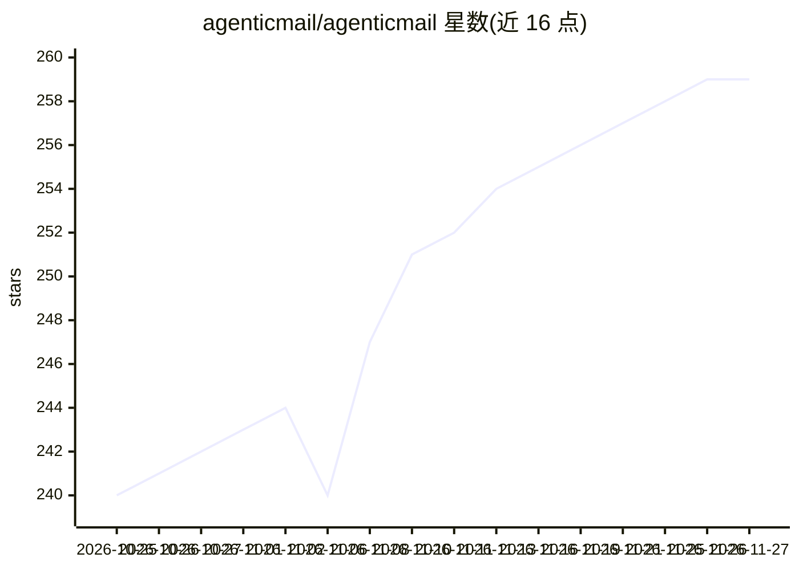

# agenticmail/agenticmail

⭐ 259 · TypeScript · MIT · 推送 2026-11-26 · [GitHub](https://github.com/agenticmail/agenticmail) · [官网](https://www.npmjs.com/package/agenticmail) · 组织维护

**给 AI agent 提供真实邮箱/短信/电话能力的通信基础设施**

为 AI agent 提供真实邮箱地址、短信收发与外呼语音通话的程序化通信基础设施。安装方式为 curl 一键脚本或 npm 全局安装 CLI 后执行 bootstrap。核心机制包括：agent 间结构化 RPC 调用（call_agent）、多 agent 邮件线程的分层 wake 上下文（ThreadCache + AgentMemory）、持久化 agent 记忆（BM25F 检索、9 类分类、置信度衰减）、实时语音桥接（OpenAI Realtime 对接 46elks/Twilio 媒体流）、以及可选的本地媒体工具集（TTS/音视频编辑），依赖 ffmpeg 等外部二进制并做特性检测。

## 筛选速览

| 维度 | 判定 | 备注 |
|---|---|---|
| AI 角色 | `ai-ecosystem` | LLM/agent 周边工具 |
| 许可风险 | `permissive` | MIT |
| 部署形态 | `self-host` | docker 或自建部署 |
| 模型依赖 | — | README 未给出锁定关系 |
| 硬件要求 | — | 无带数字的原话,不猜 |
| 安装摩擦 | `low` | 无编译、无系统依赖或容器化 |
| 成熟度 | — | 结构信号不足 |

## 能力要点

- 为 agent 分配真实邮箱与电话号码，支持邮件/SMS/外呼语音通话
- 分层 wake 上下文（ThreadCache + AgentMemory）与 wake 合并机制降低多 agent 线程 token 消耗
- 持久化 agent 记忆：BM25F 索引、置信度衰减、按 agent 隔离的 API 与 MCP 工具
- 实时语音桥接支持通话中 function-calling 与人工介入（ask_operator）

## 适用场景

- 让多个 AI agent 通过邮件线程协作并控制上下文成本
- 为 agent 配置可收发短信和接打电话的通道
- 需要 agent 在通话中调用工具或转人工确认的场景

## 场景标签

`Agent 记忆` `多智能体` · 领域:Agent 开发

## 证据(README 行号)

> L7: **The first platform to give AI agents real email addresses and phone numbers.** Send and receive email, SMS, and ve
> L32: - **Nine media tools.** `media_tts` / `media_tts_voices` (Edge text-to-speech), `media_image_edit`, `media_video_ed

## 星数曲线

2026-10-25 240 → 2026-11-27 259（+19）

---
*卡片 v1 · prompt 1.4 · 生成 2026-11-25 · 置信度 high · 依据 README sha `e6425e192652` · [字段定义](../../DATASET.md)*
