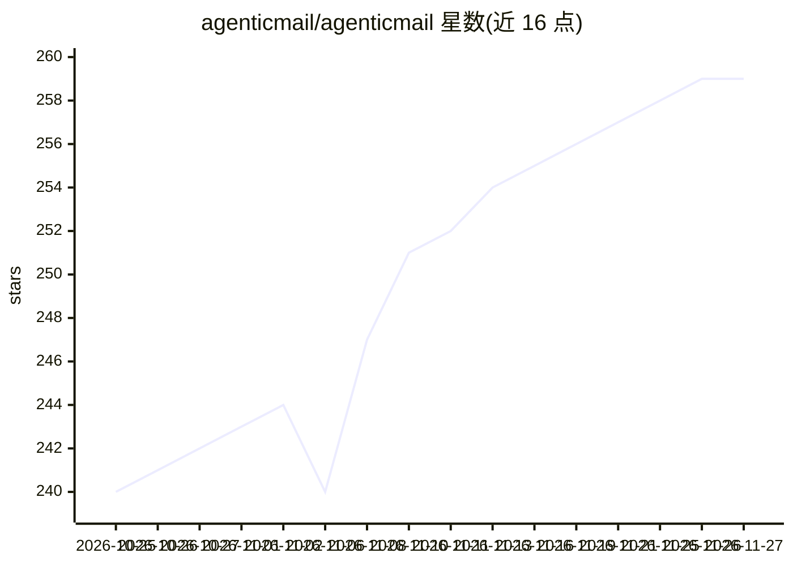

# agenticmail/agenticmail

⭐ 259 · TypeScript · MIT · 推送 2026-11-26 · [GitHub](https://github.com/agenticmail/agenticmail) · [官网](https://www.npmjs.com/package/agenticmail) · 组织维护

**给 AI agent 提供真实邮箱/短信/电话能力的通信基础设施**

为 AI agent 提供程序化收发真实邮件、短信、验证码及外呼语音电话的基础设施平台。安装通过 npm 全局 CLI 或一行 shell 安装脚本，配套 MCP 工具与 Claude Code 插件集成。核心机制包括 agent 持久记忆（BM25F 索引、置信度衰减）、多 agent 邮件线程的分层 wake 上下文以降低 token 开销、经 46elks/Twilio 的实时语音桥接（依赖 OpenAI Realtime API）。另有可选本地媒体工具集，依赖 ffmpeg 等外部二进制且不捆绑。含 0.9.111 版移除历史版本中向广告 API 发送提示词关键词的 OpenCrater sponsor hooks 的隐私公告。

## 筛选速览

| 维度 | 判定 | 备注 |
|---|---|---|
| AI 角色 | `ai-ecosystem` | LLM/agent 周边工具 |
| 许可风险 | `permissive` | MIT |
| 部署形态 | `self-host` | docker 或自建部署 |
| 模型依赖 | — | README 未给出锁定关系 |
| 硬件要求 | — | 无带数字的原话,不猜 |
| 安装摩擦 | `low` | 无编译、无系统依赖或容器化 |
| 成熟度 | — | 结构信号不足 |

## 能力要点

- 程序化收发真实邮件、短信验证码与 agent 外呼语音电话
- 46elks 与 Twilio 双电话通道，OpenAI Realtime 实时语音桥接
- 通用 agent 记忆系统（9 类别、置信度衰减、BM25F 检索）
- 分层 wake 上下文：ThreadCache + AgentMemory 降低多 agent 线程 token 成本

## 适用场景

- 让 AI agent 拥有自己的邮箱收发邮件与验证码
- agent 通过电话进行实时语音对话
- 多 agent 之间通过邮件线程协作并共享记忆上下文
- 通过 Telegram 与自己的 agent 互通消息

## 场景标签

`Agent 记忆` `多智能体` `语音 Agent` · 领域:Agent 开发

## 证据(README 行号)

> L16: **The first platform to give AI agents real email addresses and phone numbers.** Send and receive email, SMS, and v
> L41: - **Nine media tools.** `media_tts` / `media_tts_voices` (Edge text-to-speech), `media_image_edit`, `media_video_ed

## 星数曲线

2026-10-25 240 → 2026-11-27 259（+19）

---
*卡片 v1 · prompt 1.4 · 生成 2026-11-27 · 置信度 mid · 依据 README sha `cad13bcc389f` · [字段定义](../../DATASET.md)*
