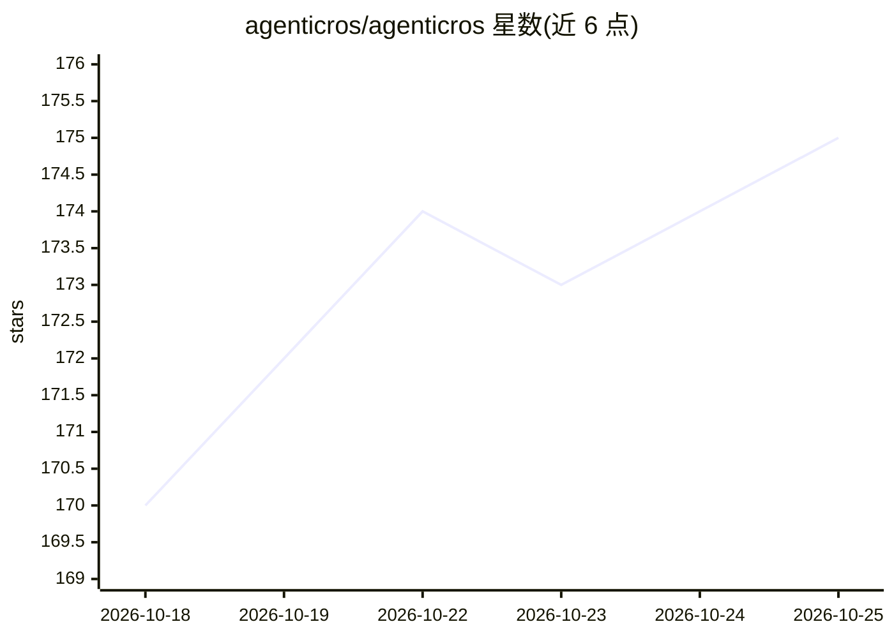

# agenticros/agenticros

⭐ 176 · C · Apache-2.0 · 推送 2026-10-25 · [GitHub](https://github.com/agenticros/agenticros) · [官网](https://agenticros.com) · 组织维护

**把 ROS 2 机器人接入各类 AI agent 的桥接接口层**

AgenticROS 是连接前沿推理模型与 ROS 2 机器人的开源接口层：通过 OpenClaw 插件、MCP server 和 Gemini CLI 等适配器，把 Claude Code/Desktop/Dispatch、Codex CLI、Hermes、Antigravity、Gemini 等接入机器人，使其可感知（相机快照、YOLOv8n 检测）与行动（cmd_vel）。核心包括能力清单（机器人广播动词式能力）、run_mission 声明式任务链、确定性自然语言目标编译器（无 LLM 依赖）、多机器人编队发现与共享记忆。支持本地 Ollama VLM 免云 API，npx 一键安装（Node≥20），另含 Gazebo/RViz 仿真、Docker 镜像与硬件搭建指南（Jetson/Pi 等）。

## 筛选速览

| 维度 | 判定 | 备注 |
|---|---|---|
| AI 角色 | `ai-ecosystem` | LLM/agent 周边工具 |
| 许可风险 | `permissive` | Apache-2.0 |
| 部署形态 | `self-host` | docker 或自建部署 |
| 模型依赖 | local-ok | 支持本地模型 |
| 硬件要求 | — | 无带数字的原话,不猜 |
| 安装摩擦 | `low` | 无编译、无系统依赖或容器化 |
| 成熟度 | — | 结构信号不足 |

## 能力要点

- 能力清单 + run_mission 声明式任务链 + 确定性 NL 目标编译器（无 LLM 依赖）
- 一套 ROS 2 工作区对接 OpenClaw/Claude/Codex/Hermes/Antigravity/Gemini 多家 agent
- 支持本地 Ollama VLM（如 qwen3-vl），无需云 API
- 多机器人编队发现、跨 agent 共享任务记忆与交接

## 适用场景

- 让 Claude Code 或 Codex CLI 通过 MCP 直接控制我的 ROS 2 机器人
- 用自然语言下达机器人任务并链式编排感知-移动步骤
- 本地 Ollama 视觉模型驱动机器人，数据不出内网
- 多机器人编队中按能力在线状态分配任务

## 场景标签

`Agent 框架` · 领域:Agent 开发

## 证据(README 行号)

> L18: AgenticROS turns ROS 2 robots into agent-native machines. Speak, type, or message — and your robot perceives, reaso
> L34: AgenticROS is built so that new adapters (LangGraph, OpenAI, local models, voice stacks, etc.) can be added without
> L64: - **Adapters**: OpenClaw plugin (`packages/agenticros`, including NemoClaw); MCP server (`packages/agenticros-claud

## 星数曲线

2026-10-18 170 → 2026-10-25 175（+5）

---
*卡片 v1 · prompt 1.4 · 生成 2026-10-22 · 置信度 high · 依据 README sha `4dc662cee7a6` · [字段定义](../../DATASET.md)*
