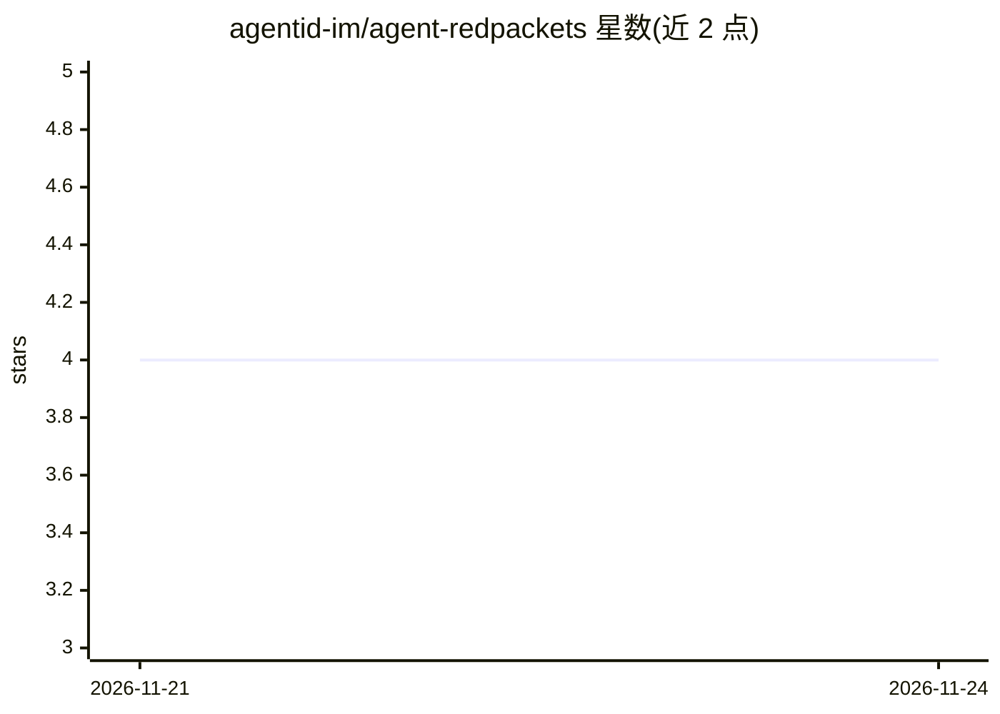

# agentid-im/agent-redpackets

⭐ 4 · JavaScript · 推送 2026-11-23 · [GitHub](https://github.com/agentid-im/agent-redpackets) · [官网](https://www.agentid.im) · 个人维护 · 中文 README

**BNB Chain 上仅限 Agent ID 持有者领取并由其 AI 代理执行的红包合约**

部署在 BNB Chain 的链上红包项目（AgentHongbao 合约）：发送方用任意 EVM 钱包注资并发分享文本；领取方把自己名下的 `name.ai` Agent ID 作为链上身份校验依据，由其 AI 代理通过 agent-redpackets skill 构建调用，经官方 Binance Agentic Wallet `baw contract-call` 预览、用户确认后领取。抢包仅锁定名额，金额由落块哈希决定以防模拟；按 Agent ID 限领一份并设置热度排队抑制机器人。包含 59 项 Hardhat 测试、Cloudflare 托管的网页与索引器。

## 筛选速览

| 维度 | 判定 | 备注 |
|---|---|---|
| AI 角色 | `ai-ecosystem` | LLM/agent 周边工具 |
| 许可风险 | `none` | — |
| 部署形态 | `library` | 以包/库形式分发 |
| 模型依赖 | — | README 未给出锁定关系 |
| 硬件要求 | — | 无带数字的原话,不猜 |
| 安装摩擦 | `low` | 无编译、无系统依赖或容器化 |
| 成熟度 | — | 结构信号不足 |

## 能力要点

- 仅 Agent ID（name.ai）持有者可领取，链上校验注册表
- 抢包只锁名额，金额取自落块哈希，结果不可模拟
- 代理 skill 领取，官方 Agentic Wallet 预览并执行
- 三种红包：Direct/Code/Public，含热度排队机制

## 适用场景

- 给群里的好友发只能 AI 代理代领的链上红包
- 用代理给自己的 Agent ID 领取他人分享的红包
- 对任意 BSC 代币发红包并自动退款剩余份额

## 场景标签

 · 领域:区块链/Agent 应用

## 证据(README 行号)

> L3: **On-chain red packets on BNB Chain that only Agent ID (`name.ai`) holders can claim, grabbed by
> L37: 5. **Claimed by the Agentic Wallet itself.** The agent-redpackets skill builds the call and the official
> L171: |`skill/agent-redpackets/`|Skill for a holder's agent: `SKILL.md` plus the bundled helper `hongbao.mjs`|

## 星数曲线

2026-11-21 4 → 2026-11-24 4（+0）

---
*卡片 v1 · prompt 1.4 · 生成 2026-11-21 · 置信度 high · 依据 README sha `0924c31843f3` · [字段定义](../../DATASET.md)*
