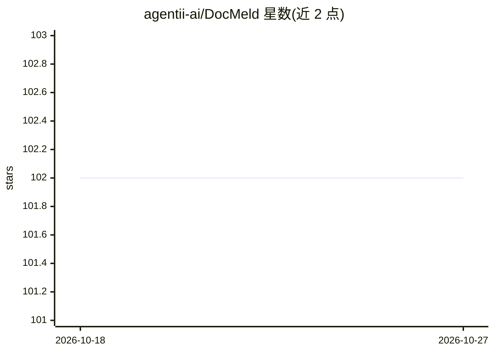

# agentii-ai/DocMeld

⭐ 102 · Python · 推送 2026-09-15 · [GitHub](https://github.com/agentii-ai/DocMeld) · [官网](https://www.agentii.ai) · 组织维护

**面向 AI agent 的 PDF/Word/PPT 结构化知识流水线**

Python 库与 CLI，将 PDF、Word、PowerPoint 文档经 Bronze→Silver→Gold 三阶段转换为结构化元素 JSON、逐页 JSONL 与可选 AI 富化元数据，无需 OCR/VLM/多模态模型；Bronze/Silver 阶段离线运行，Gold 阶段用 DeepSeek-chat 加语义描述。支持可插拔解析后端（PyMuPDF/Docling/python-pptx/LibreOffice），并可生成 PRD、工作流、主题聚类与 Claude Code 技能文件；LLM 后端可通过 LLMProvider 协议替换。面向为 RAG 与 agent 系统准备文档数据的开发者。

## 筛选速览

| 维度 | 判定 | 备注 |
|---|---|---|
| AI 角色 | `ai-ecosystem` | LLM/agent 周边工具 |
| 许可风险 | `permissive` | — |
| 部署形态 | `library` | 以包/库形式分发 |
| 模型依赖 | locked-api |  |
| 硬件要求 | — | 无带数字的原话,不猜 |
| 安装摩擦 | `low` | 无编译、无系统依赖或容器化 |
| 成熟度 | — | 结构信号不足 |

## 能力要点

- 三阶段 Bronze→Silver→Gold 流水线，各阶段幂等可独立运行
- Bronze/Silver 完全离线，无需 OCR/VLM 与模型下载
- 14 种元素类型的 Pydantic 统一 schema（标题/表格/图表/公式/SmartArt 等）
- 可生成 PRD、工作流、主题聚类与 Claude Code 技能文件，LLM 后端可替换

## 适用场景

- 把论文/书籍转成 RAG 分块检索所需的逐页知识
- 从文档批量生成 Claude Code 技能文件
- 对论文集做主题聚类与 AI 元数据富化

## 场景标签

`文档解析` · 领域:知识与检索

## 证据(README 行号)

> L24: Most tools stop at format conversion. DocMeld goes further: **Document → Structured Elements → Page Knowledge → AI-
> L146: Beyond per-page enrichment, DocMeld can generate structured, agent-ready artifacts from document content:
> L272: The gold stage is entirely optional. Bronze and silver stages run offline with no API keys, no network calls, and 

## 星数曲线

2026-10-18 102 → 2026-10-27 102（+0）

---
*卡片 v1 · prompt 1.4 · 生成 2026-10-23 · 置信度 high · 依据 README sha `47d3847a3dcd` · [字段定义](../../DATASET.md)*
