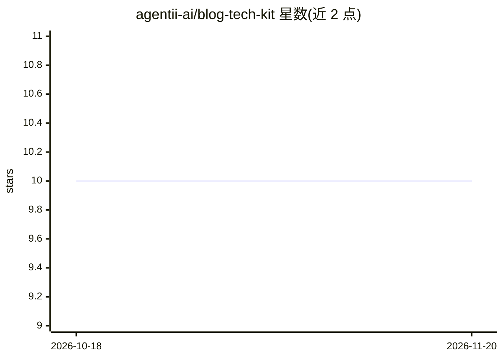

# agentii-ai/blog-tech-kit

⭐ 10 · Shell · MIT · 推送 2025-12-05 · [GitHub](https://github.com/agentii-ai/blog-tech-kit) · [官网](https://kits.agentii.ai) · 组织维护

**面向创始人与内容团队的规范驱动博客策略与执行工具包**

基于 Spec-Kit 方法论改造的博客领域工具包：通过 `blog init` CLI 初始化含模板、章程与 agent 斜杠命令的项目，再在用户选择的 AI 编码代理（Claude Code、Cursor、Windsurf 等 18 种）中执行 /blogkit.* 五阶段工作流——specify 定义受众与内容支柱、clarify 消歧、plan 制定编辑流程、tasks 拆解生产任务、implement 执行。提供 bash/PowerShell 双脚本变体、8 条章程原则与参考资料目录，支持与 Spec-Kit 等多个 kit 变体共存。

## 筛选速览

| 维度 | 判定 | 备注 |
|---|---|---|
| AI 角色 | `ai-native` | 本体是模型或模型工具 |
| 许可风险 | `permissive` | MIT |
| 部署形态 | `None` |  |
| 模型依赖 | locked-api |  |
| 硬件要求 | — | 无带数字的原话,不猜 |
| 安装摩擦 | `low` | 无编译、无系统依赖或容器化 |
| 成熟度 | — | 结构信号不足 |

## 能力要点

- 9 个 /blogkit.* 斜杠命令覆盖规格→澄清→规划→任务→执行五阶段
- 为 18 个 AI 代理提供项目模板（bash 与 PowerShell 各一套）
- uvx 一键运行或 uv tool install 持久安装
- 支持与 Spec-Kit、pmf-kit 等多 kit 命名空间共存

## 适用场景

- 为 AI/LLM SaaS 产品从零搭建权威博客的内容策略
- 用 AI 代理按结构化工作流批量生产技术文章
- 为产品博客或思想领袖博客生成编辑流程与任务清单

## 场景标签

`AI 写作` · 领域:内容生成

## 证据(README 行号)

> L5:  A spec-driven toolkit for systematic blog content strategy and execution, built on the foundations of spec-kit.
> L16: While Spec-Kit enables spec-driven software development with AI agents, **Blog-Tech-Kit applies the same methodolog
> L86: Open your AI assistant (Claude Code, Cursor, Windsurf, etc.) in the project directory. You'll see `/blogkit.*` comm

## 星数曲线

2026-10-18 10 → 2026-11-20 10（+0）

---
*卡片 v1 · prompt 1.4 · 生成 2026-11-20 · 置信度 high · 依据 README sha `0a4a3e146544` · [字段定义](../../DATASET.md)*
