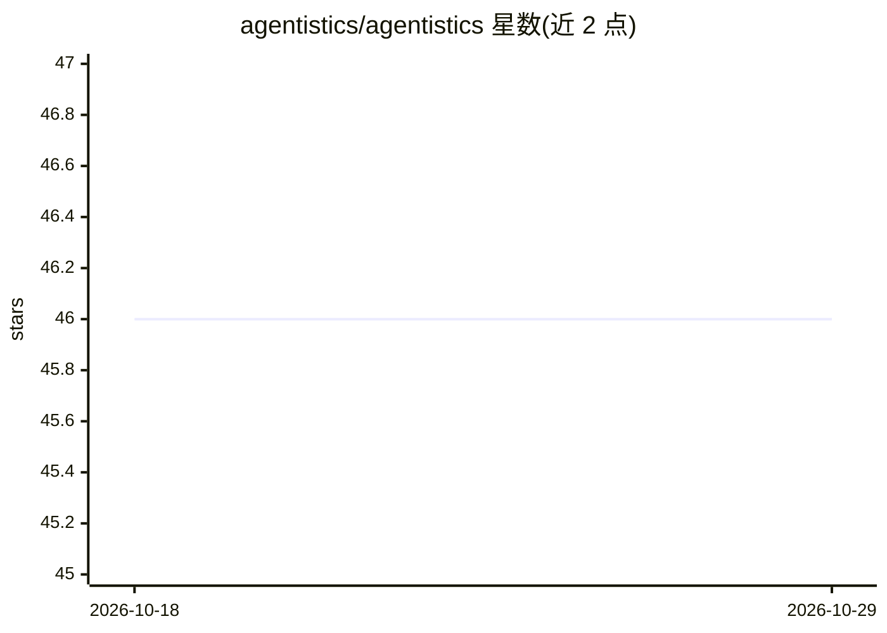

# agentistics/agentistics

⭐ 46 · TypeScript · NOASSERTION · 推送 2026-10-28 · [GitHub](https://github.com/agentistics/agentistics) · [官网](https://agentistics.com.br) · 组织维护

**本地优先的 AI 编码助手用量分析工具：读取六种 CLI 的数据算 token 与成本**

读取 Claude Code、Codex CLI、Gemini CLI、GitHub Copilot CLI、Antigravity、Kimi Code 六种 AI 编码助手写入本地的数据，生成 token、成本、会话与活动指标。单机模式不发起外连；Team Mode 下成员仅上报聚合指标、不上传聊天内容，由 central（Docker 服务）聚合多机数据。提供终端控制中心、Web 仪表盘、CLI（agentop），支持按 git remote 归组仓库、标签、CI 上报（GitHub OIDC）与公开暴露前的安全预检。成本按三层定价来源合并计算。Linux/WSL 经脚本或 npm 安装，Windows 提供 .msi/.exe。

## 筛选速览

| 维度 | 判定 | 备注 |
|---|---|---|
| AI 角色 | `ai-ecosystem` | LLM/agent 周边工具 |
| 许可风险 | `none` | NOASSERTION |
| 部署形态 | `desktop` | 安装包/桌面程序 |
| 模型依赖 | — | README 未给出锁定关系 |
| 硬件要求 | — | 无带数字的原话,不猜 |
| 安装摩擦 | `low` | 无编译、无系统依赖或容器化 |
| 成熟度 | — | 结构信号不足 |

## 能力要点

- 跟踪六种 AI 编码助手的 token、成本与活动指标
- 本地优先：单机不开外连，Team Mode 仅上报计算后的指标
- central 聚合多机数据，含账号体系、TOTP 两步验证与共享规则控制
- GitHub Actions 临时 runner 通过 OIDC 认证上报 CI 指标

## 适用场景

- 统计我个人或团队各 AI 编码助手的 token 消耗与花费
- 按 git 仓库/客户标签聚合查看成本并做预算预测
- 对比多个编码助手的用量与工具调用情况

## 场景标签

`LLM 可观测性` · 领域:评测与运维

## 证据(README 行号)

> L36: agentistics reads what your AI coding assistants already write to disk and turns it into
> L43: |Harness|Read from|Tokens & cost|Agent metrics|Notes|

## 星数曲线

2026-10-18 46 → 2026-10-29 46（+0）

---
*卡片 v1 · prompt 1.4 · 生成 2026-10-25 · 置信度 high · 依据 README sha `f5a0c1abf351` · [字段定义](../../DATASET.md)*
