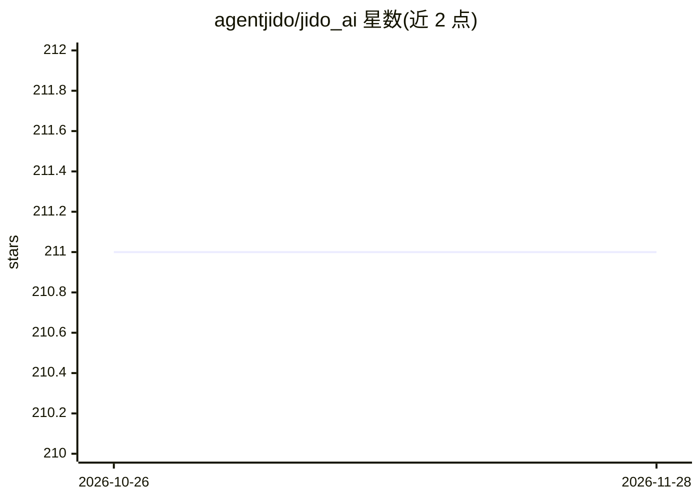

# agentjido/jido_ai

⭐ 211 · Elixir · Apache-2.0 · 推送 2026-11-24 · [GitHub](https://github.com/agentjido/jido_ai) · [官网](https://jido.run/ecosystem/jido_ai) · 组织维护

**Elixir agent 的 AI 集成层：LLM 编排与推理策略**

Jido 生态的核心包，作为 agent 的 AI 运行时层：以 Elixir 模块定义工具与 agent，通过内置模型路由、重试与可观测性运行同步/异步请求。提供 8 类内置推理策略（ReAct、CoD、CoT、AoT、ToT、GoT、TRM、Adaptive），支持请求级工具过滤、流式输出与 checkpoint/resume，也可经 `Jido.AI.ask/2` 等直接调用一次性文本生成。通过 Hex 包分发，支持 Igniter 一键安装。

## 筛选速览

| 维度 | 判定 | 备注 |
|---|---|---|
| AI 角色 | `ai-ecosystem` | LLM/agent 周边工具 |
| 许可风险 | `permissive` | Apache-2.0 |
| 部署形态 | `None` |  |
| 模型依赖 | — | README 未给出锁定关系 |
| 硬件要求 | — | 无带数字的原话,不猜 |
| 安装摩擦 | `low` | 无编译、无系统依赖或容器化 |
| 成熟度 | — | 结构信号不足 |

## 能力要点

- 8 类内置推理策略（ReAct/CoD/CoT/AoT/ToT/GoT/TRM/Adaptive）
- ask/await 请求句柄防止并发结果覆盖，请求级工具过滤
- 统一工具契约 Jido.Action，编译期安全
- 稳定 telemetry 事件名与策略/配额插件

## 适用场景

- 构建带工具调用循环的长生命周期 agent
- 按任务选择固定推理策略（数学/逻辑用 CoT 等）
- 在现有工作流中嵌入 LLM 调用而无需 agent 进程

## 场景标签

`Agent 框架` · 领域:Agent 开发

## 证据(README 行号)

> L33: `jido_ai` is the AI runtime layer for Jido. You define tools and agents as Elixir modules, then run synchronous or 
> L29: Build tool-using Elixir agents with explicit reasoning strategies and production-ready request orchestration.

## 星数曲线

2026-10-26 211 → 2026-11-28 211（+0）

---
*卡片 v1 · prompt 1.4 · 生成 2026-11-25 · 置信度 high · 依据 README sha `82cbcf58db1a` · [字段定义](../../DATASET.md)*
