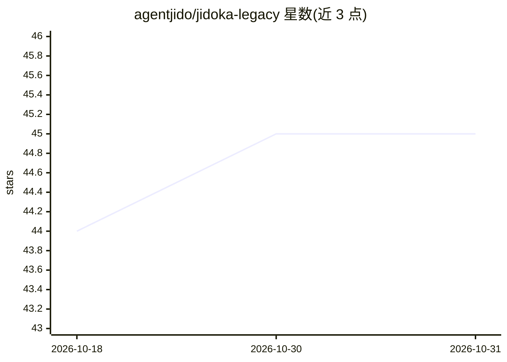

# agentjido/jidoka-legacy

⭐ 45 · Elixir · Apache-2.0 · 推送 2026-10-27 · [GitHub](https://github.com/agentjido/jidoka-legacy) · [官网](https://jido.run/ecosystem/jidoka) · 组织维护

**面向应用开发的 Elixir LLM agent 框架，构建可暂停审查的 agent**

构建于 Jido 与 Jido AI 之上的 Elixir agent 框架：通过 Spark DSL 或 JSON/YAML 定义 agent，编译为不可变的 Agent.Spec，将模型调用与工具操作收敛到单一 effect 边界以便确定性测试；支持会话状态、流式输出、控制中断生成可序列化快照供人工审查后恢复、导入导出可移植 agent 数据。运行时依赖 ReqLLM 访问 OpenAI/Anthropic 等提供商。项目已宣布多数功能并入 Jido v3/Jido AI v3，本包停止积极开发并将逐步淘汰，后续以 Jidokka 之名发布新产品。需 Elixir 1.18+，当前为 0.9.1 beta。

## 筛选速览

| 维度 | 判定 | 备注 |
|---|---|---|
| AI 角色 | `ai-ecosystem` | LLM/agent 周边工具 |
| 许可风险 | `permissive` | Apache-2.0 |
| 部署形态 | `None` |  |
| 模型依赖 | — | README 未给出锁定关系 |
| 硬件要求 | — | 无带数字的原话,不猜 |
| 安装摩擦 | `low` | 无编译、无系统依赖或容器化 |
| 成熟度 | `idea` | |

## 能力要点

- DSL/JSON/YAML 定义 agent，编译为不可变可检视的 Agent.Spec
- 控制机制可暂停 turn 并生成快照，支持人工审批后恢复
- 单一 effect 边界允许注入确定性 LLM/操作能力做离线测试
- 会话、幂等策略、追踪、preflight 检查均有显式契约

## 适用场景

- 在 Elixir 应用中构建带人工审查环节的 LLM agent
- 为 agent 挂接 Jido actions、MCP 工具、Ash 资源作为模型操作
- 离线确定性测试 agent 逻辑后再接入真实提供商

## 场景标签

`Agent 框架` · 领域:Agent 开发

## 证据(README 行号)

> L20: Jidoka turns agent definitions into inspectable, resumable model and tool
> L44: - **Jido native:** Jido actions, agent processes, browser tools, MCP tools, Ash

## 星数曲线

2026-10-18 44 → 2026-10-31 45（+1）

---
*卡片 v1 · prompt 1.4 · 生成 2026-10-25 · 置信度 high · 依据 README sha `dc816ff8ef3d` · [字段定义](../../DATASET.md)*
