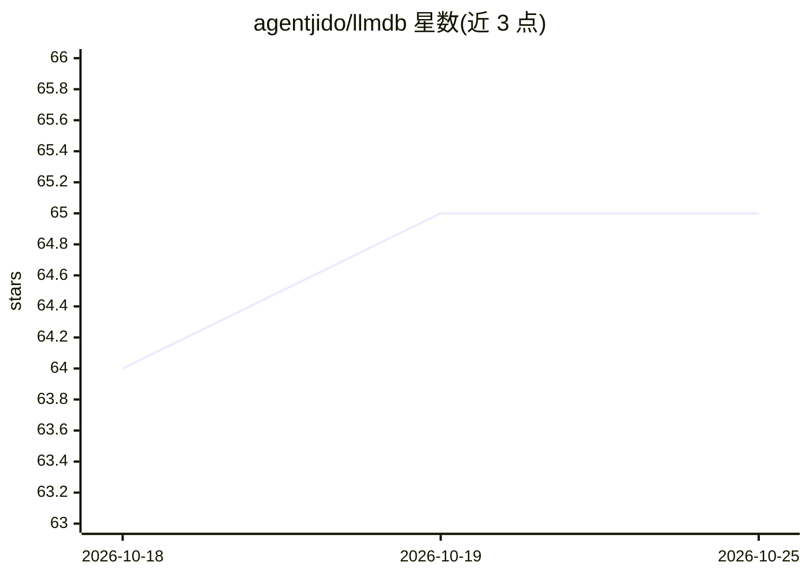

# agentjido/llmdb

⭐ 65 · Elixir · Apache-2.0 · 推送 2026-10-22 · [GitHub](https://github.com/agentjido/llmdb) · [官网](https://llmcatalog.dev) · 组织维护

**面向开发者的 LLM 模型元数据目录库：离线快照+能力检索**

提供 LLM 提供商与模型元数据的本地打包快照，供 Elixir/Node.js 应用在运行时查询。核心接口 model_spec 字符串（"provider:model" 或 "model@provider"）解析为校验后的 Provider/Model 结构体，支持按能力（工具调用、模态等）筛选模型，读取基于 :persistent_term 的 O(1) 查询。默认随包发布快照、无需网络；区分描述性目录元数据与类型化执行元数据（runtime/execution），不可执行条目标记 catalog_only。版本采用 CalVer，提供 mix 任务拉取与重建上游数据。

## 筛选速览

| 维度 | 判定 | 备注 |
|---|---|---|
| AI 角色 | `ai-ecosystem` | LLM/agent 周边工具 |
| 许可风险 | `permissive` | Apache-2.0 |
| 部署形态 | `library` | 以包/库形式分发 |
| 模型依赖 | — | README 未给出锁定关系 |
| 硬件要求 | — | 无带数字的原话,不猜 |
| 安装摩擦 | `low` | 无编译、无系统依赖或容器化 |
| 成熟度 | — | 结构信号不足 |

## 能力要点

- 打包快照离线查询，默认无需网络
- model_spec 双格式解析与按能力筛选（select/candidates）
- 类型化 runtime/execution 元数据契约，区分可执行与仅目录条目
- 同时发布 Hex 包与 npm 包（@agentjido/llmdb）

## 适用场景

- 在 LLM 应用中按能力（如 tools）选择合适的 provider:model
- 离线环境校验与查询模型元数据
- 为自定义/本地模型注册私有 provider 条目
- 追溯模型元数据的历史变更（History 模块）

## 场景标签

 · 领域:LLM 基础设施/元数据

## 证据(README 行号)

> L12: LLM model metadata catalog with fast, capability-aware lookups. Use simple `"provider:model"` or `"model@provider"`
> L29: LLM DB gives that moving catalog a refreshable snapshot pattern: pull upstream
> L133: - **`select/1`** — pick first match by capabilities → `{:ok, {provider, id}}` | `{:error, :no_match}`

## 星数曲线

2026-10-18 64 → 2026-10-25 65（+1）

---
*卡片 v1 · prompt 1.4 · 生成 2026-10-24 · 置信度 high · 依据 README sha `8364baecfd71` · [字段定义](../../DATASET.md)*
