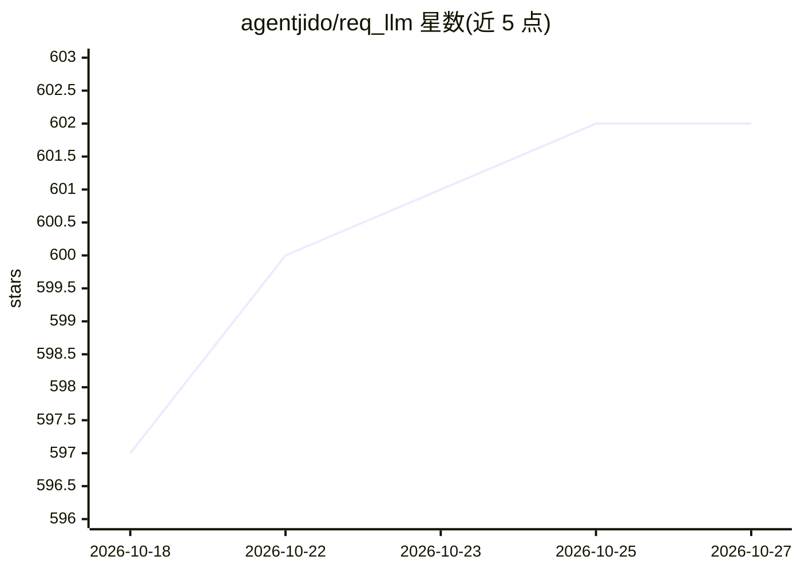

# agentjido/req_llm

⭐ 602 · Elixir · Apache-2.0 · 推送 2026-10-26 · [GitHub](https://github.com/agentjido/req_llm) · [官网](https://jido.run/ecosystem/req_llm) · 组织维护

**Elixir 统一 LLM 客户端库：跨 21 家提供商标准化调用**

基于 Req 与 Finch 的可组合 Elixir 库，为 LLM API 调用提供统一接口：高层函数（generate_text/stream_text/generate_object 等）将请求与响应在各提供商间标准化，由提供商回调层翻译模型元数据、选项与响应体。模型注册表经 llm_db 来自 LLMDB，收录 21 个已实现提供商集成的 1,205 个模型，覆盖文本、嵌入、图像生成、语音、转录、rerank 与 OCR 元数据。另提供结构化输出、流式传输（Finch）、用量与成本追踪、分层密钥管理与可选的模型路由 behaviour。面向在 Elixir 应用中接入多家 LLM API 的开发者，以 Hex 包安装。

## 筛选速览

| 维度 | 判定 | 备注 |
|---|---|---|
| AI 角色 | `ai-ecosystem` | LLM/agent 周边工具 |
| 许可风险 | `permissive` | Apache-2.0 |
| 部署形态 | `None` |  |
| 模型依赖 | local-ok | 支持本地模型 |
| 硬件要求 | — | 无带数字的原话,不猜 |
| 安装摩擦 | `low` | 无编译、无系统依赖或容器化 |
| 成熟度 | — | 结构信号不足 |

## 能力要点

- 21 个已实现提供商集成 / 1,205 个模型（LLMDB 目录）
- generate_text/stream_text/generate_object 等统一 API，Req 负责请求响应、Finch 负责流式
- 结构化输出（JSON schema / function calling 三种模式）与嵌入生成
- 分层密钥管理：请求覆盖 → 应用配置 → 环境变量 → .env 文件

## 适用场景

- 在 Elixir 应用中用统一接口调用多家 LLM 提供商
- 为文本模型添加结构化 JSON 输出约束
- 追踪 LLM 调用的用量与美元成本
- 通过 Ollama / LM Studio 调用本地模型

## 场景标签

`模型网关` · 领域:Agent 开发

## 证据(README 行号)

> L13: A Req- and Finch-backed package to call LLM APIs that standardizes requests and responses across providers.
> L21: - **High-level API** – Vercel AI SDK-inspired functions (`generate_text/3`, `stream_text/3`, `generate_object/4` an
> L22: - **Provider transports** – Req powers request/response calls; Finch powers streaming. Provider callbacks translate

## 星数曲线

2026-10-18 597 → 2026-10-27 602（+5）

---
*卡片 v1 · prompt 1.4 · 生成 2026-10-21 · 置信度 high · 依据 README sha `6494b53650ed` · [字段定义](../../DATASET.md)*
