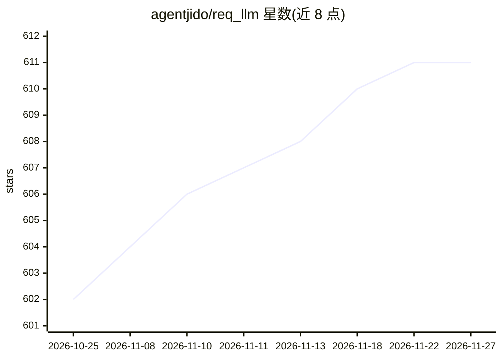

# agentjido/req_llm

⭐ 611 · Elixir · Apache-2.0 · 推送 2026-11-26 · [GitHub](https://github.com/agentjido/req_llm) · [官网](https://jido.run/ecosystem/req_llm) · 组织维护

**Elixir 开发者跨厂商统一调用 LLM API 的库**

基于 Req 和 Finch 的 Elixir 库，用于调用 LLM API，统一各 provider 的请求与响应格式。提供受 Vercel AI SDK 启发的高层函数（generate_text、stream_text、generate_object 等），覆盖文本、嵌入、图像、语音、转录、rerank、OCR 等操作；模型元数据来自 LLMDB，接入路径分为专用 provider 模块与共享目录网关两种。通过 Hex.pm 分发，可用 Igniter 安装；两个 provider（Amazon Bedrock、Google Vertex）需可选认证依赖。README 记录了 1.9.0–1.28.0 存在 WebSocket TLS 证书未校验的安全漏洞（GHSA-6vww-5m28-f26v）。

## 筛选速览

| 维度 | 判定 | 备注 |
|---|---|---|
| AI 角色 | `ai-ecosystem` | LLM/agent 周边工具 |
| 许可风险 | `permissive` | Apache-2.0 |
| 部署形态 | `None` |  |
| 模型依赖 | local-ok | 支持本地模型 |
| 硬件要求 | — | 无带数字的原话,不猜 |
| 安装摩擦 | `low` | 无编译、无系统依赖或容器化 |
| 成熟度 | — | 结构信号不足 |

## 能力要点

- 统一接口覆盖 30+ 托管 API 与 Ollama/LM Studio/vLLM 本地运行时
- 文本、嵌入、图像、语音、转录、rerank、OCR 操作元数据
- 结构化输出生成与 OpenAI 原生 JSON schema 三种模式
- 应用可定义 Model Router behaviour 做模型路由

## 适用场景

- 在 Elixir 应用中以同一 API 调用多家 LLM provider
- 通过 Ollama/vLLM 等本地运行时生成文本
- 生成结构化 JSON 输出与批量嵌入

## 场景标签

`模型网关` · 领域:Agent 开发

## 证据(README 行号)

> L13: A Req- and Finch-backed package to call LLM APIs that standardizes requests and responses across providers.
> L21: - **High-level API** – Vercel AI SDK-inspired functions (`generate_text/3`, `stream_text/3`, `generate_object/4` an
> L22: - **Provider transports** – Req powers request/response calls; Finch powers streaming. Dedicated provider modules o

## 星数曲线

2026-10-25 602 → 2026-11-27 611（+9）

---
*卡片 v1 · prompt 1.4 · 生成 2026-11-25 · 置信度 high · 依据 README sha `b9ad152558e0` · [字段定义](../../DATASET.md)*
