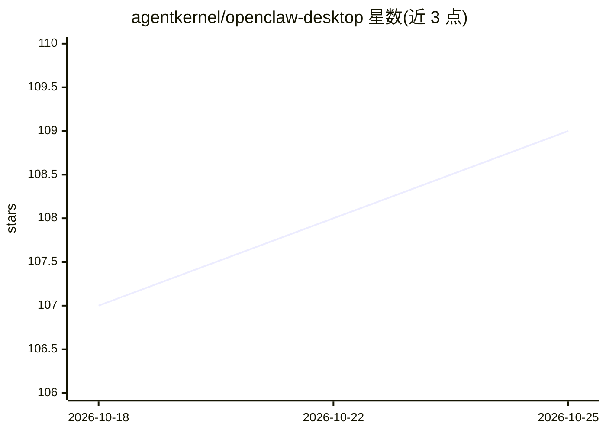

# agentkernel/openclaw-desktop

⭐ 109 · TypeScript · NOASSERTION · 推送 2026-04-03 · [GitHub](https://github.com/agentkernel/openclaw-desktop) · [官网](https://github.com/agentkernel/openclaw-desktop/releases/latest) · 组织维护 · 中文 README

**OpenClaw AI 智能体的 Windows 一键安装器与原生桌面壳**

面向 Windows 10/11 用户的 OpenClaw 社区分发版：将 OpenClaw 运行时（固定 2026.4.2）与便携 Node.js 打包为单个 .exe 安装包，提供安装向导（模型服务商→渠道→网关）、开始菜单/托盘原生壳、内置更新与回滚、飞书配对与白名单管理界面。支持 50+ 模型服务商（OpenAI/Claude/Gemini/DeepSeek 等）与 Telegram/Discord/Slack/飞书等多渠道。仅 Windows x64，GPL-3.0，声明非 OpenClaw 核心项目官方所属。

## 筛选速览

| 维度 | 判定 | 备注 |
|---|---|---|
| AI 角色 | `ai-ecosystem` | LLM/agent 周边工具 |
| 许可风险 | `none` | NOASSERTION |
| 部署形态 | `desktop` | 安装包/桌面程序 |
| 模型依赖 | — | README 未给出锁定关系 |
| 硬件要求 | — | 无带数字的原话,不猜 |
| 安装摩擦 | `low` | 无编译、无系统依赖或容器化 |
| 成熟度 | — | 结构信号不足 |

## 能力要点

- 单 .exe 一键安装，内置便携 Node.js 与固定版本 OpenClaw 运行时
- 引导式配置向导：模型服务商→渠道→网关
- 内置更新器与任意历史版本回滚
- 飞书配对审批、白名单与 open_id 管理全部在应用内完成

## 适用场景

- 在 Windows 上不碰终端安装并运行 OpenClaw 智能体
- 通过图形界面配置模型服务商与消息渠道
- 管理飞书机器人的配对请求与用户白名单

## 场景标签

`AI 助手` · 领域:对话与助手

## 证据(README 行号)

> L30: **OpenClaw Desktop** packages the OpenClaw runtime into a standard Windows install experience. Download one `.exe`,
> L92: |🔽 **One-click installer**|Native Windows `.exe` installer — no `npm install` or system-wide Node.js needed|
> L111: OpenClaw Desktop is a **community-maintained Windows distribution** for the OpenClaw ecosystem. Part of the OpenCl

## 星数曲线

2026-10-18 107 → 2026-10-25 109（+2）

---
*卡片 v1 · prompt 1.4 · 生成 2026-10-23 · 置信度 mid · 依据 README sha `db4379fb962b` · [字段定义](../../DATASET.md)*
