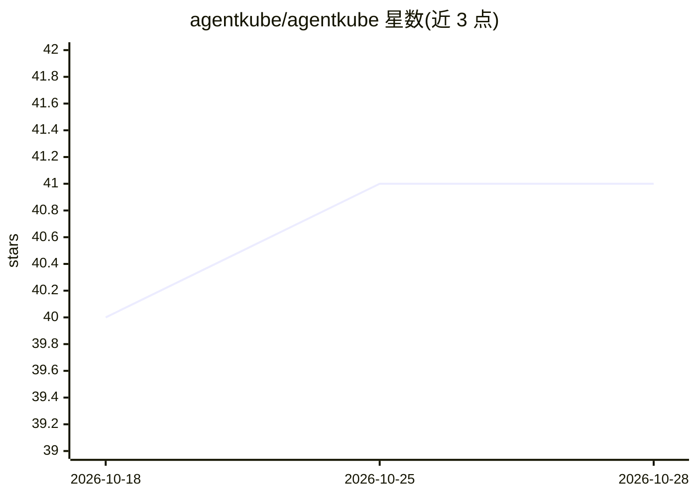

# agentkube/agentkube

⭐ 41 · TypeScript · Apache-2.0 · 推送 2026-03-01 · [GitHub](https://github.com/agentkube/agentkube) · [官网](https://agentkube.com) · 组织维护

**AI 驱动的 Kubernetes IDE，用自然语言管理集群**

面向开发者与 DevOps 工程师的 AI Kubernetes IDE：通过自然语言界面自动化集群管理，内置多 agent 编排的根因分析、AI 日志/事件分析、LogQL 与 PromQL 查询构建器、资源拓扑图与攻击路径可视化、监控仪表盘。支持 20+ LLM 提供商（BYOK）及 Ollama/vLLM 本地模型，提供 Human-in-the-loop 工具调用审批与只读 Recon 模式。桌面安装提供 Homebrew（macOS）与各平台安装包（当前 v0.0.12），Windows 版未签名。

## 筛选速览

| 维度 | 判定 | 备注 |
|---|---|---|
| AI 角色 | `ai-ecosystem` | LLM/agent 周边工具 |
| 许可风险 | `permissive` | Apache-2.0 |
| 部署形态 | `None` |  |
| 模型依赖 | local-ok | 支持本地模型 |
| 硬件要求 | — | 无带数字的原话,不猜 |
| 安装摩擦 | `low` | 无编译、无系统依赖或容器化 |
| 成熟度 | — | 结构信号不足 |

## 能力要点

- 多 agent 编排的集群问题调查与根因分析
- 支持 20+ LLM 提供商（BYOK）与 Ollama/vLLM 本地模型
- Human-in-the-loop 工具调用审批与只读 Recon 模式
- 资源拓扑图、攻击路径分析、Grype 镜像漏洞扫描、KRR 资源推荐

## 适用场景

- 用自然语言操作和排查 Kubernetes 集群问题
- 在隔离/隐私环境用本地 LLM 管理集群
- 可视化查看资源依赖与安全攻击路径

## 场景标签

 · 领域:云原生/DevOps 工具

## 证据(README 行号)

> L17: Agentkube is an AI-powered Kubernetes IDE that bridges the gap between developers and complex cluster operations. I
> L22: - **Bring Your Own Key** — Supports 20+ LLM providers including OpenAI, Anthropic, Google Gemini, Mistral, Cohere, 
> L23: - **Local LLM Support** — Run models locally with Ollama and vLLM for air-gapped and privacy-first environments.

## 星数曲线

2026-10-18 40 → 2026-10-28 41（+1）

---
*卡片 v1 · prompt 1.4 · 生成 2026-10-25 · 置信度 high · 依据 README sha `00e35cc23b0e` · [字段定义](../../DATASET.md)*
