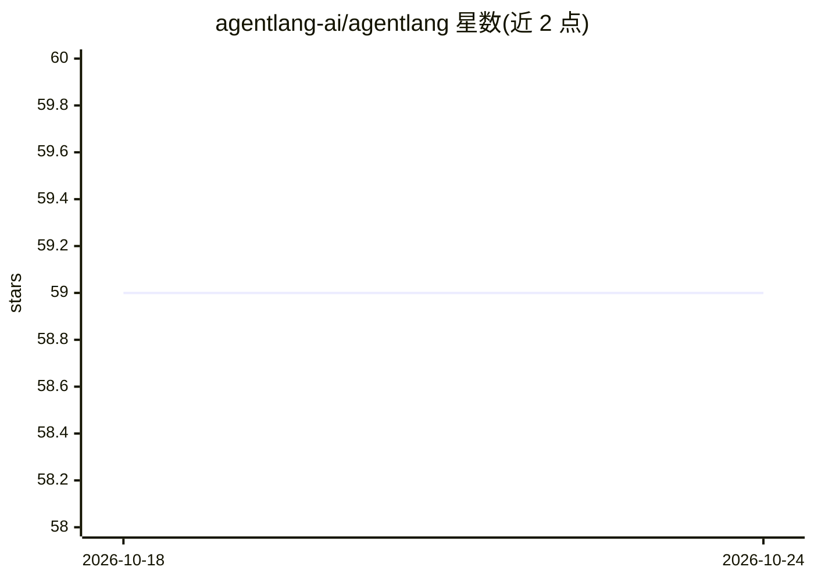

# agentlang-ai/agentlang

⭐ 59 · JavaScript · NOASSERTION · 推送 2026-10-07 · [GitHub](https://github.com/agentlang-ai/agentlang) · [官网](https://fractl.io/agentlang) · 组织维护 · 中文 README

**构建企业级 AI Agent 的声明式 DSL 与全栈框架**

基于 TypeScript 的声明式 DSL，用于定义、版本化、运行与监控 AI Agent 团队及其应用基础设施（数据模型、工作流、RBAC、集成与 UI），官方称之为 Team-as-Code。核心机制包括 Agentic Reliability Modeling（Flows、Decisions、Directives、Scenarios、Glossary 等语言构造）与 AgentLang Ontology（实体建模、自动生成 CRUD/UI、声明式 RBAC）。运行时内置 LLM、数据库、向量库与认证的原生集成，编译到 Node.js 也可在浏览器运行，另有 Studio 可视化构建器标注为 coming soon。通过 npm CLI 安装，供开发者构建 Agentic 应用。

## 筛选速览

| 维度 | 判定 | 备注 |
|---|---|---|
| AI 角色 | `ai-ecosystem` | LLM/agent 周边工具 |
| 许可风险 | `none` | NOASSERTION |
| 部署形态 | `library` | 以包/库形式分发 |
| 模型依赖 | — | README 未给出锁定关系 |
| 硬件要求 | — | 无带数字的原话,不猜 |
| 安装摩擦 | `low` | 无编译、无系统依赖或容器化 |
| 成熟度 | — | 结构信号不足 |

## 能力要点

- 声明式 DSL 内置 Flows/Decisions/Directives/Scenarios/Glossary 等 Agent 可靠性建模构造
- Ontology 提供数据模型、自动生成 CRUD/UI 与声明式 RBAC
- 运行时原生集成 LLM、数据库、向量 DB 与认证，连接器目录含 Salesforce/ServiceNow/Snowflake 等
- 编译到 Node.js 并可运行于浏览器，可复用现有 JavaScript 库

## 适用场景

- 用声明式 DSL 定义并运行多 Agent 协作的完整应用
- 为 Agent 增加流程、决策表与场景示例以约束其行为
- 企业场景中一体化管理数据模型、工作流与访问控制

## 场景标签

`多智能体` `Agent 框架` · 领域:Agent 开发

## 证据(README 行号)

> L17: Agentlang is a declarative DSL (built on TypeScript) for creating AI Agents and full-stack Agentic Apps. With Agent
> L50: Build **teams of reliable AI Agents** that follow your organization's processes closely, while adapting to new scen

## 星数曲线

2026-10-18 59 → 2026-10-24 59（+0）

---
*卡片 v1 · prompt 1.4 · 生成 2026-10-24 · 置信度 high · 依据 README sha `bb57565b8c66` · [字段定义](../../DATASET.md)*
