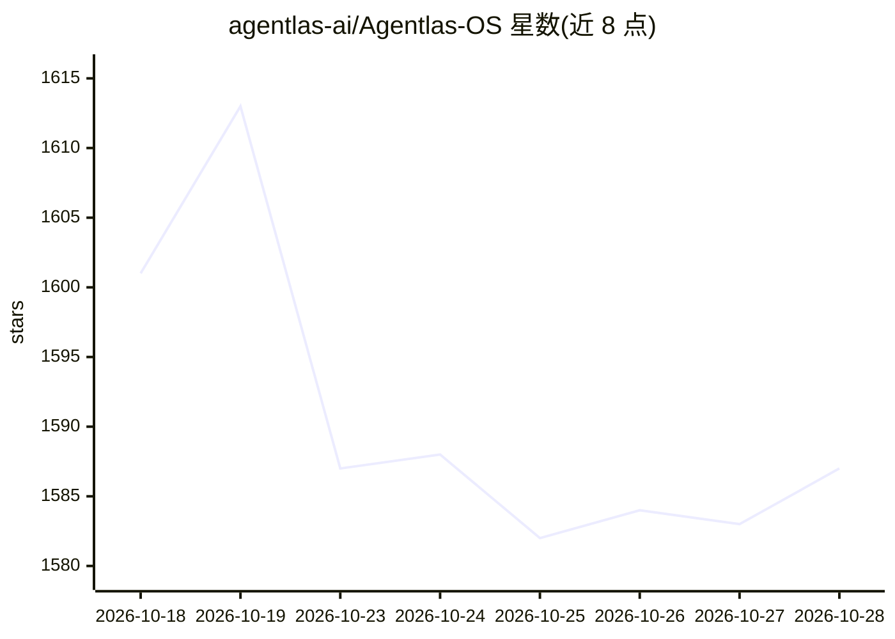

# agentlas-ai/Agentlas-OS

⭐ 1,587 · Python · Apache-2.0 · 推送 2026-10-27 · [GitHub](https://github.com/agentlas-ai/Agentlas-OS) · [官网](https://agentlas.cloud) · 组织维护 · 中文 README

**在 Claude Code/Codex/Cursor 等宿主内组建专家 agent 团队的开源路由引擎**

Agentlas OS（Hephaestus）是运行在 CLI agent 宿主（Claude Code、Codex、Cursor、Antigravity 等）中的构建与路由引擎：把请求拆分为带角色与交接顺序的任务，从本机、私有云和公共 Hub 三个来源为每个任务匹配候选 agent，由用户模型自行选择；运行中规划、执行、综合与验证分开调用，需独立验证器通过。遵循 A2A v1.0 agent card 标准，支持签名卡身份验证、按 digest 固定版本。通过 curl 脚本安装，不写 $HOME 之外；另有桌面应用与免费公共 Hub。角色本体除开发外还含保险精算、并购尽调等非开发领域。

## 筛选速览

| 维度 | 判定 | 备注 |
|---|---|---|
| AI 角色 | `ai-ecosystem` | LLM/agent 周边工具 |
| 许可风险 | `permissive` | Apache-2.0 |
| 部署形态 | `desktop` | 安装包/桌面程序 |
| 模型依赖 | — | README 未给出锁定关系 |
| 硬件要求 | — | 无带数字的原话,不猜 |
| 安装摩擦 | `low` | 无编译、无系统依赖或容器化 |
| 成熟度 | — | 结构信号不足 |

## 能力要点

- 任务拆分→agent 匹配→独立验证的三步流程
- A2A v1.0 标准 agent card 读写与签名身份验证
- 候选列表不排名，由用户模型选择并记录理由
- 自动配置机器上发现的所有受支持宿主（MCP/插件/命令注册）

## 适用场景

- 在 Claude Code/Cursor 里让多领域专家 agent 分工完成复杂任务
- 构建并发布自己的专家 agent 到私有云或公共 Hub
- 管理本机与云端 agent，按需为每个任务匹配候选人

## 场景标签

`Agent 框架` `多智能体` · 领域:Agent 开发

## 证据(README 行号)

> L194: |**Agentlas OS (Hephaestus)**|This repo — the open-source build and routing engine and command surface for your CL
> L71: - **A2A v1.0, as written.** Agent cards are read and written at the standard

## 星数曲线

2026-10-18 1,601 → 2026-10-28 1,587（-14）

---
*卡片 v1 · prompt 1.4 · 生成 2026-10-21 · 置信度 high · 依据 README sha `02bd87f9c392` · [字段定义](../../DATASET.md)*
