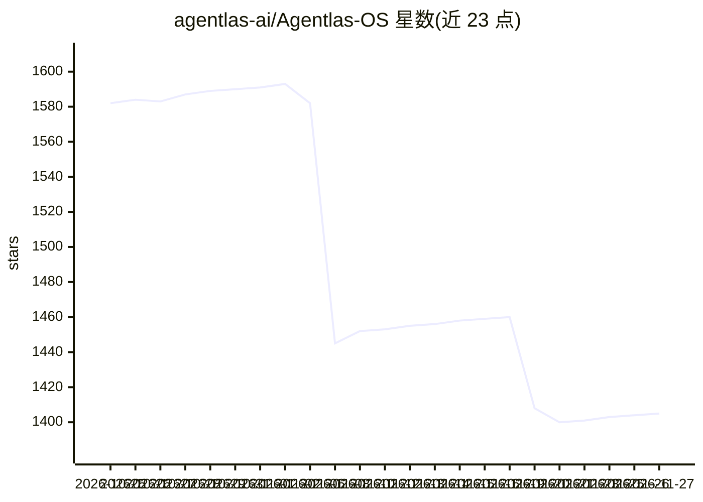

# agentlas-ai/Agentlas-OS

⭐ 1,405 · Python · Apache-2.0 · 推送 2026-11-25 · [GitHub](https://github.com/agentlas-ai/Agentlas-OS) · [官网](https://agentlas.cloud) · 组织维护 · 中文 README

**本地运行的 AI Agent 编排 OS：任务分解、招聘执行、凭据校验**

Agentlas OS 是一个开源（Apache-2.0）本地优先的 agent 运行时，核心是 Hephaestus 引擎：将目标分解为任务图，从本地工具、私有 Agent Cloud 与公共 Hub 三层招募执行者，任务完成需独立 verifier 校验执行凭据。附带 One/Finance/Science 三个工作流、按项目隔离的记忆治理（memory-hooks、Policy Gate）、A2A 打包，以及桌面与手机配对的决策卡片交互。模型接入采用 BYOM：可挂接 Claude Code、Codex、Cursor 等编码代理，或用 Ollama 等本地模型。安装走 curl 脚本或签名桌面安装包。

## 筛选速览

| 维度 | 判定 | 备注 |
|---|---|---|
| AI 角色 | `ai-ecosystem` | LLM/agent 周边工具 |
| 许可风险 | `permissive` | Apache-2.0 |
| 部署形态 | `desktop` | 安装包/桌面程序 |
| 模型依赖 | local-ok | 支持本地模型 |
| 硬件要求 | — | 无带数字的原话,不猜 |
| 安装摩擦 | `low` | 无编译、无系统依赖或容器化 |
| 成熟度 | — | 结构信号不足 |

## 能力要点

- Hephaestus 三阶段引擎：任务分解→三层招募→独立校验执行凭据
- 本地优先，无需 VM，代理直接操作本机文件与工具
- 按项目隔离的记忆治理（Memory Curator、Policy Gate）
- BYOM：Claude Code/Codex/Cursor 挂接或 Ollama 本地模型

## 适用场景

- 让自主代理在本机完成跨多步骤的项目型任务
- 个人投资研究报告生成并保留计算依据
- 跨多台电脑与手机配对管理多个代理

## 场景标签

`多智能体` `GUI 自动化` `AI 助手` `金融量化` · 领域:Agent 开发

## 证据(README 行号)

> L22: Built to lead entire projects rather than isolated prompts. Model-agnostic (BYOM) and native to Claude Code, Codex,
> L51: Give Agentlas OS one objective. The Hephaestus engine decomposes it, searches for specialists on your computer, in 

## 星数曲线

2026-10-25 1,582 → 2026-11-27 1,405（-177）

---
*卡片 v1 · prompt 1.4 · 生成 2026-11-23 · 置信度 high · 依据 README sha `689ce9a546db` · [字段定义](../../DATASET.md)*
