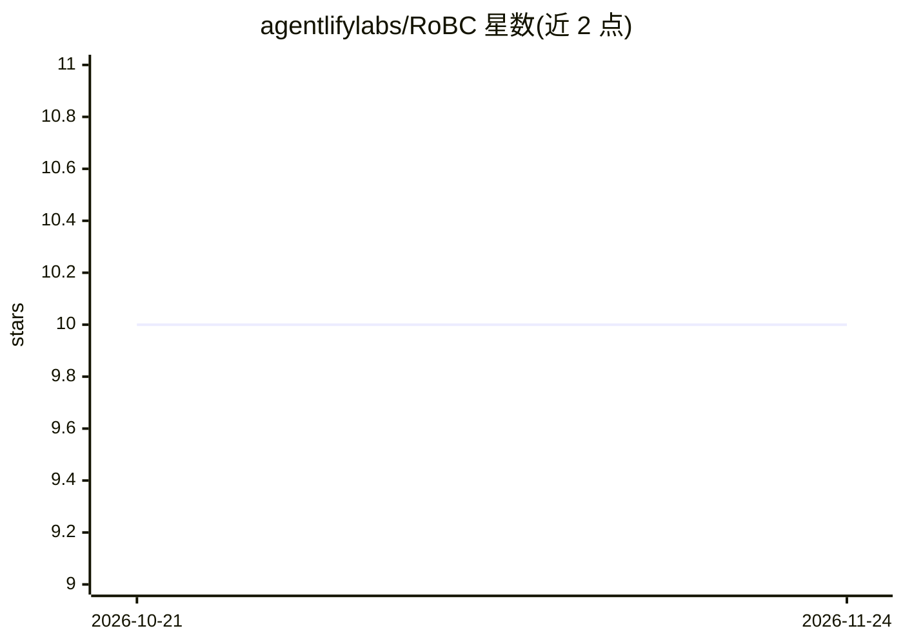

# agentlifylabs/RoBC

⭐ 10 · Python · Apache-2.0 · 推送 2026-10-02 · [GitHub](https://github.com/agentlifylabs/RoBC) · [官网](https://agentlify.co) · 组织维护

**在线学习 LLM 路由器：按语义聚类动态分发请求**

面向动态生产环境的在线学习 LLM 路由库：以 k 近邻+softmax 将请求嵌入划入语义簇，对每个（模型，簇）对维护贝叶斯后验，用 Thompson Sampling 在探索与利用间取舍选模型；每次请求的反馈在线更新后验，模型质量漂移或新增模型时无需重训流程。提供 route/update/add_model/save_posteriors 等 API，路由决策约 1ms，可将学习到的后验保存为 JSON。以 Python 包安装，要求 Python 3.9+。

## 筛选速览

| 维度 | 判定 | 备注 |
|---|---|---|
| AI 角色 | `ai-ecosystem` | LLM/agent 周边工具 |
| 许可风险 | `permissive` | Apache-2.0 |
| 部署形态 | `library` | 以包/库形式分发 |
| 模型依赖 | — | README 未给出锁定关系 |
| 硬件要求 | — | 无带数字的原话,不猜 |
| 安装摩擦 | `low` | 无编译、无系统依赖或容器化 |
| 成熟度 | — | 结构信号不足 |

## 能力要点

- Thompson Sampling + 语义聚类的在线路由，无需重训流程
- 支持动态添加新模型并以无信息先验参与探索
- route_with_details 返回选中模型、簇权重与采样分数
- 后验可保存/加载为 JSON 文件

## 适用场景

- 生产环境中在多个 LLM 间按任务类型自动分发请求
- 模型频繁更新或新增、无法维护静态重训管道的场景
- 对路由决策开销敏感的服务接入

## 场景标签

`模型网关` · 领域:Agent 开发

## 证据(README 行号)

> L6: RoBC is an **online learning LLM router** designed for **dynamic production environments**. Using Thompson Sampling 
> L103: 1. **Cluster Manager**: Assigns prompts to semantic clusters using k-nearest neighbors with softmax weighting
> L105: 3. **Thompson Sampler**: Selects models by sampling from posteriors, naturally balancing exploration and exploitat

## 星数曲线

2026-10-21 10 → 2026-11-24 10（+0）

---
*卡片 v1 · prompt 1.4 · 生成 2026-11-20 · 置信度 high · 依据 README sha `1c8843e38ddc` · [字段定义](../../DATASET.md)*
