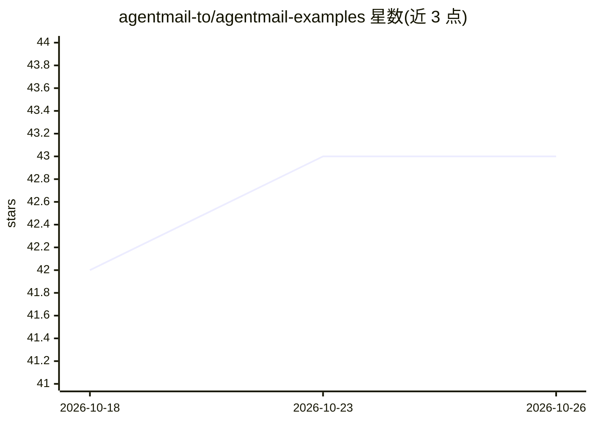

# agentmail-to/agentmail-examples

⭐ 43 · Python · 推送 2026-08-11 · [GitHub](https://github.com/agentmail-to/agentmail-examples) · [官网](https://agentmail.to) · 组织维护

**AgentMail 邮件 API 的 AI agent 示例与模板合集**

AgentMail（面向 AI agent 的邮件 API）官方维护的示例仓库：提供 LangChain/OpenAI 终端入门示例、自主回信/销售/晚餐协调/GitHub 维护等进阶示例，以及生产力、销售、客服、财务、营销等类别的生产级 agent 模板（Python + TypeScript 双实现，针对真实 AgentMail 与 Claude API 端到端测试）。需 AgentMail API key；支持 git clone 整库或 npx degit 拉取单个模板后 pip 安装运行。

## 筛选速览

| 维度 | 判定 | 备注 |
|---|---|---|
| AI 角色 | `ai-knowledge` | 知识聚合/清单类 |
| 许可风险 | `none` | — |
| 部署形态 | `library` | 以包/库形式分发 |
| 模型依赖 | — | README 未给出锁定关系 |
| 硬件要求 | — | 无带数字的原话,不猜 |
| 安装摩擦 | `low` | 无编译、无系统依赖或容器化 |
| 成熟度 | — | 结构信号不足 |

## 能力要点

- 覆盖入门、进阶到生产级模板的多层级示例集
- 模板含 Python + TypeScript 双实现并经端到端测试
- npx degit 可按需拉取单个模板而非整个 monorepo
- 模板集成日历附件、PDF 发票识别、x402 自动付款等功能

## 适用场景

- 为 AI agent 接入独立邮箱能力寻找现成代码起点
- 搭建自动客服、发票处理、邮件分类路由等邮件 agent
- 学习 agent 与邮件 API 的编排模式

## 场景标签

`教程课程` · 领域:学习与行业

## 证据(README 行号)

> L1: # AgentMail Examples
> L3: Build AI agents with their own email inboxes. Requires an AgentMail API key — sign up free.
> L25: Production-ready agent templates. Each has matching Python + TypeScript implementations and is tested end-to-end ag

## 星数曲线

2026-10-18 42 → 2026-10-26 43（+1）

---
*卡片 v1 · prompt 1.4 · 生成 2026-10-25 · 置信度 high · 依据 README sha `1754ac910ff4` · [字段定义](../../DATASET.md)*
