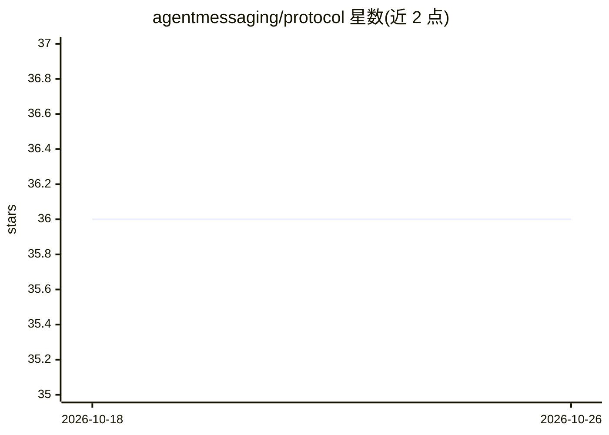

# agentmessaging/protocol

⭐ 36 · Apache-2.0 · 推送 2026-10-23 · [GitHub](https://github.com/agentmessaging/protocol) · [官网](https://agentmessaging.org) · 组织维护

**AI agent 间安全通信的开放联邦协议规范**

由 23blocks 维护的开放协议规范：定义结构化 agent 地址（agent@tenant.provider）、Ed25519 消息签名、信任级标注、本地优先存储与跨 provider 路由，使不同系统上的 AI agent 可互相发现、认证并通信。包含 13 份规范文档（身份、注册、消息、路由、联邦、安全、API 等），提供 REST+WebSocket 接口；列有 AI Maestro 参考实现与 Claude Code Plugin。Quick Start 为 API 调用示例（openssl 生成密钥、curl 收发消息），Apache 2.0 许可。

## 筛选速览

| 维度 | 判定 | 备注 |
|---|---|---|
| AI 角色 | `ai-ecosystem` | LLM/agent 周边工具 |
| 许可风险 | `permissive` | Apache-2.0 |
| 部署形态 | `None` |  |
| 模型依赖 | — | README 未给出锁定关系 |
| 硬件要求 | — | 无带数字的原话,不猜 |
| 安装摩擦 | `low` | 无编译、无系统依赖或容器化 |
| 成熟度 | — | 结构信号不足 |

## 能力要点

- 结构化 agent 地址与跨 provider 联邦路由
- Ed25519 签名与规范化签名格式、重放保护
- 外部消息信任级标注用于提示注入防御
- 13 份规范文档与 REST+WebSocket API

## 适用场景

- 让不同平台上的 agent 互相委派任务与共享上下文
- CI/CD 流水线中多个 agent 协作通知
- 企业跨部门 agent 间带密码学认证的通信

## 场景标签

`多智能体` · 领域:Agent 开发

## 证据(README 行号)

> L3: **The Open Standard for AI Agent Communication** - A federated protocol enabling AI agents to discover, authenticate
> L40: Agent Messaging Protocol (AMP) provides a standard way for AI agents to communicate with structured addresses:

## 星数曲线

2026-10-18 36 → 2026-10-26 36（+0）

---
*卡片 v1 · prompt 1.4 · 生成 2026-10-25 · 置信度 high · 依据 README sha `3914e19e8ac1` · [字段定义](../../DATASET.md)*
