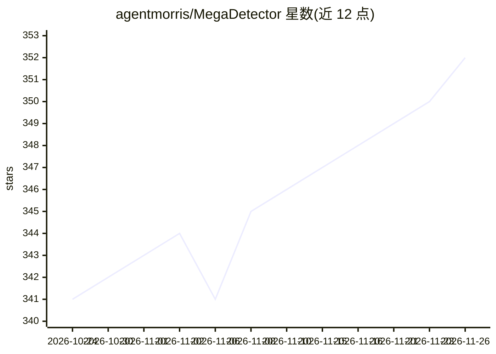

# agentmorris/MegaDetector

⭐ 352 · Python · MIT · 推送 2026-11-25 · [GitHub](https://github.com/agentmorris/MegaDetector) · 组织维护

**生态研究者的相机陷阱图像检测模型：识别动物/人/车辆**

一个面向保护生物学领域的目标检测模型，在数百万张多生态系统相机陷阱图像上训练，识别图像中的动物、人和车辆，并可据此剔除空白图像；只定位目标、不区分物种。仓库提供模型训练与运行工具、批量结果审查工具、相机陷阱元数据格式转换、可视化及 COCO Camera Traps 数据管理代码，以 Python 包发布（pip install megadetector），另推荐 GUI 工具 AddaxAI 和 SpeciesNet 物种分类器配合使用。

## 筛选速览

| 维度 | 判定 | 备注 |
|---|---|---|
| AI 角色 | `ai-native` | 本体是模型或模型工具 |
| 许可风险 | `permissive` | MIT |
| 部署形态 | `library` | 以包/库形式分发 |
| 模型依赖 | — | README 未给出锁定关系 |
| 硬件要求 | — | 无带数字的原话,不猜 |
| 安装摩擦 | `low` | 无编译、无系统依赖或容器化 |
| 成熟度 | — | 结构信号不足 |

## 能力要点

- 识别相机陷阱图像中的动物、人、车辆，支持剔除空白图像
- 提供训练、运行模型及处理批量输出的工具链
- 支持相机陷阱元数据格式转换与 COCO Camera Traps 数据库管理
- 提供 Python 包（pip install megadetector）与 mamba/conda 环境文件

## 适用场景

- 批量处理相机陷阱图像，筛除空白图片
- 在物种分类前先检测动物位置
- 批量审查模型检测结果并整理元数据

## 场景标签

`目标检测` `科研工具` · 领域:学习与行业

## 证据(README 行号)

> L7: MegaDetector is an AI model that identifies animals, people, and vehicles in camera trap images (which also makes it
> L20: * If you're a programmer-type looking to use tools from this repo, check out the MegaDetector Python package that p
> L161: - Tools for training and running MegaDetector.

## 星数曲线

2026-10-24 341 → 2026-11-26 352（+11）

---
*卡片 v1 · prompt 1.4 · 生成 2026-11-25 · 置信度 high · 依据 README sha `fb746edbda60` · [字段定义](../../DATASET.md)*
