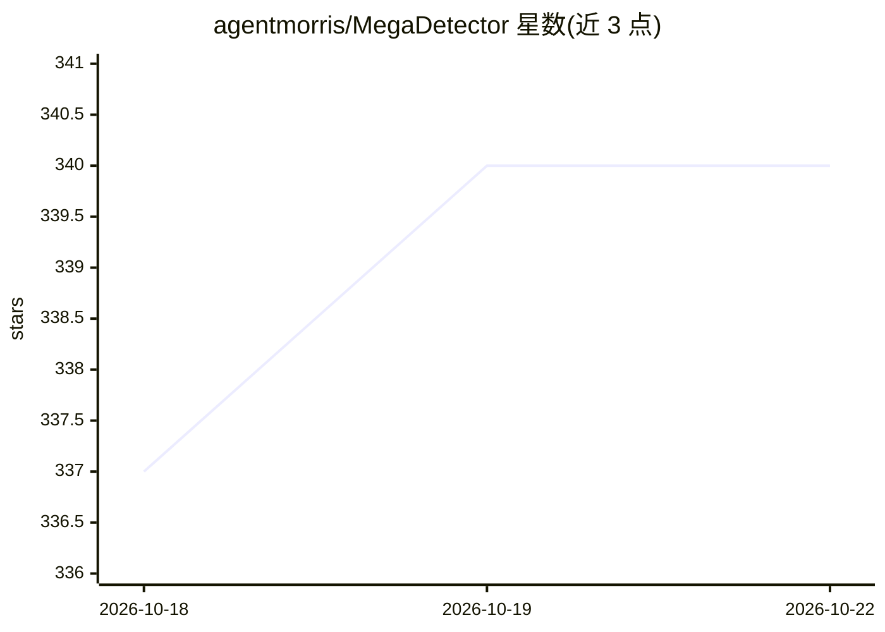

# agentmorris/MegaDetector

⭐ 341 · Python · MIT · 推送 2026-10-20 · [GitHub](https://github.com/agentmorris/MegaDetector) · 组织维护

**相机陷阱图像中检测动物/人/车辆的 AI 模型及工具集**

面向保护生物学研究者的目标检测模型：在相机陷阱图像中定位动物、人和车辆并输出边界框，可用于剔除空白图像；在数百万张多生态系统的图像上训练。不做物种级识别，物种分类推荐配合 SpeciesNet 使用。仓库还提供训练/运行模型、结果后处理（生成预览页、按 AI 结果分类文件夹）、相机陷阱元数据格式转换（COCO Camera Traps）等工具；Python 包可通过 pip 安装，另有 conda 环境文件；分类相关目录已标记为 deprecated。

## 筛选速览

| 维度 | 判定 | 备注 |
|---|---|---|
| AI 角色 | `ai-native` | 本体是模型或模型工具 |
| 许可风险 | `permissive` | MIT |
| 部署形态 | `library` | 以包/库形式分发 |
| 模型依赖 | — | README 未给出锁定关系 |
| 硬件要求 | — | 无带数字的原话,不猜 |
| 安装摩擦 | `low` | 无编译、无系统依赖或容器化 |
| 成熟度 | — | 结构信号不足 |

## 能力要点

- 检测动物/人/车辆三类目标并输出边界框，可剔除空白图像
- 提供训练与运行 MegaDetector 的工具
- 后处理工具：结果预览页、按 AI 结果分文件夹、格式转换
- 元数据格式转换（转为 COCO Camera Traps 格式）与分类名到标准分类体系的映射

## 适用场景

- 相机陷阱海量图像中过滤空白图像，减少人工标注工作量
- 定位图像中的动物/人/车辆以辅助物种分类流程
- 转换与可视化相机陷阱元数据数据库

## 场景标签

`目标检测` · 领域:感知与多模态

## 证据(README 行号)

> L7: MegaDetector is an AI model that identifies animals, people, and vehicles in camera trap images (which also makes it
> L161: - Tools for training and running MegaDetector.

## 星数曲线

2026-10-18 337 → 2026-10-22 340（+3）

---
*卡片 v1 · prompt 1.4 · 生成 2026-10-21 · 置信度 high · 依据 README sha `f6687e81db9e` · [字段定义](../../DATASET.md)*
