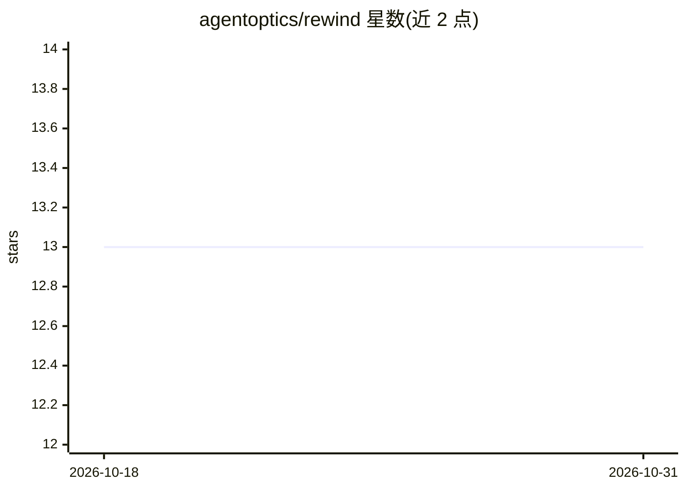

# agentoptics/rewind

⭐ 13 · Rust · MIT · 推送 2026-05-25 · [GitHub](https://github.com/agentoptics/rewind) · [官网](https://agentoptics.dev/) · 组织维护

**AI agent 时间旅行调试器：任意步分叉重放验证修复**

面向 LLM agent 开发者的开源调试工具，以单二进制 CLI + Python SDK 提供。通过透明代理或进程内 monkey-patch 录制每次 LLM 调用；agent 在某步失败后可在该步分叉时间线，修复代码后仅重跑出错步骤（前置步骤走缓存，0 token），diff 原始与分叉时间线；`rewind fix` 用 LLM 诊断失败并可选 `--apply` 自动验证；含数据集评测（7 种评估器含 LLM-as-judge）、回归基线、多 agent span 树、Web 面板、OTel 导出与 MCP Server（26 工具）。可导入 Langfuse/Datadog/OTel 生产 trace，或独立使用。限制：`--apply` 需代理录制的会话。

## 筛选速览

| 维度 | 判定 | 备注 |
|---|---|---|
| AI 角色 | `ai-ecosystem` | LLM/agent 周边工具 |
| 许可风险 | `permissive` | MIT |
| 部署形态 | `library` | 以包/库形式分发 |
| 模型依赖 | locked-api |  |
| 硬件要求 | — | 无带数字的原话,不猜 |
| 安装摩擦 | `low` | 无编译、无系统依赖或容器化 |
| 成熟度 | — | 结构信号不足 |

## 能力要点

- 任意步 fork + replay：前置步骤缓存回放（0 token/0ms），仅重跑修复步骤
- `rewind fix` LLM 诊断失败并建议修复（换模型/系统提示/温度/重试），可自动应用验证
- 评测体系：数据集 + 7 种评估器（含 LLM-as-judge），CI 可用 --fail-below 阈值
- 单二进制零依赖，含 Web 面板、Langfuse/OTel trace 导入导出、MCP Server（26 工具）

## 适用场景

- agent 生产失败后不重跑全链路，定位并只重放出错的那一步
- 改了提示词后用 LLM-as-judge 对比分叉前后时间线，证明修复有效
- 把 Langfuse 里的坏 trace 导入本地分叉调试，再导出修复
- 在 CI 中对录制会话做回归测试防止改坏

## 场景标签

`LLM 可观测性` `模型评测` · 领域:评测与运维

## 证据(README 行号)

> L19: > **Rewind is an open-source time-travel debugger for LLM-powered AI agents.** Every observability tool - Langfuse,
> L39: |**Fork & Replay**|Branch the execution timeline at any step. Fix your code, run `rewind replay --from 4`. Steps 1-
> L221: |**OpenTelemetry Export**|Export recorded sessions as OTel traces via OTLP to Langfuse, Datadog, Grafana Tempo, Ja

## 星数曲线

2026-10-18 13 → 2026-10-31 13（+0）

---
*卡片 v1 · prompt 1.4 · 生成 2026-10-31 · 置信度 high · 依据 README sha `4a6d1ba71400` · [字段定义](../../DATASET.md)*
