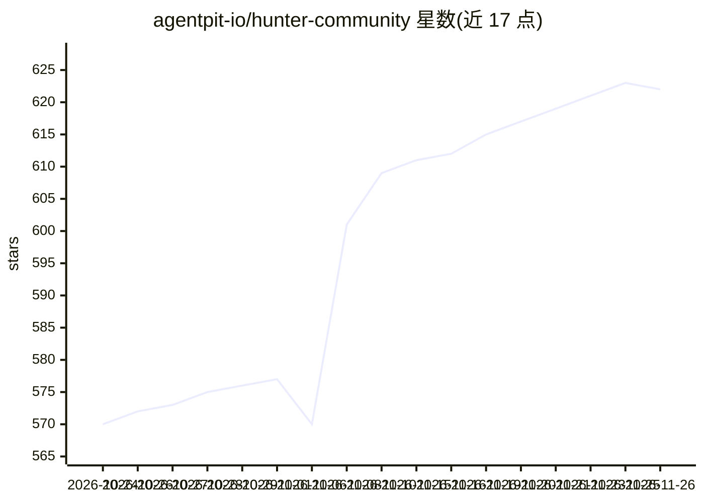

# agentpit-io/hunter-community

⭐ 622 · Python · Apache-2.0 · 推送 2026-11-16 · [GitHub](https://github.com/agentpit-io/hunter-community) · [官网](https://hunter-community.agentpit.io) · 组织维护 · 中文 README

**自部署多智能体投研终端，覆盖 A股/港股/美股分析**

HunterCode 是自托管的 AI 投研分析工具：通过 20 个 MCP 服务（69 个工具）与 22 个金融 SKILL 组织行情查询、财报 PDF 解析、个股分析、选股筛选、模拟盘交易等工作流，数据与对话存于本地数据库，用户自带大模型 key 或使用内置额度。部署方式包括 docker compose、服务器安装脚本与桌面启动器。定位为私募机构私有化部署、券商接口联调与个人投资者使用；README 声明输出为 AI 生成内容，不构成投资建议，不接券商实盘交易。

## 筛选速览

| 维度 | 判定 | 备注 |
|---|---|---|
| AI 角色 | `ai-native` | 本体是模型或模型工具 |
| 许可风险 | `permissive` | Apache-2.0 |
| 部署形态 | `desktop` | 安装包/桌面程序 |
| 模型依赖 | local-ok | 支持本地模型 |
| 硬件要求 | — | 无带数字的原话,不猜 |
| 安装摩擦 | `low` | 无编译、无系统依赖或容器化 |
| 成熟度 | — | 结构信号不足 |

## 能力要点

- 20 个 MCP 服务（含 8 个券商只读 MCP）与 22 个金融投研 SKILL
- 智能炒股模拟盘：只追加账本 + Temporal 六大交易时点调度 + 经验库自进化闭环
- 支持 OpenAI 兼容 Key（DeepSeek/Claude/Qwen/Ollama 等）热切换与调用日志跟踪
- docker compose 自托管 / 服务器脚本 / 桌面启动器三种部署路径

## 适用场景

- 私募机构做私有化部署的投研分析终端
- 个人投资者本地管理自选股、持仓与每日复盘
- 把券商公开数据与大模型方法论接进自己的分析流程

## 场景标签

`多智能体` `金融量化` · 领域:Agent 开发

## 证据(README 行号)

> L9: **自部署的 AI 投研助手 · A股 / 港股 / 美股 · AtomCode 5.1.0 提速内核 · 20 个 MCP + 22 个金融 SKILL · 数据和对话都在你自己的机器上**
> L71: **它是什么** —— 一个跑在你自己电脑或服务器上的金融 AI 投研终端。你给它一个大模型 key（或直接用内置免费额度），它就能查行情、拉新闻、读 PDF 财报、做个股深度分析、预测走势、管理自选和持仓、跑模拟盘智能交易，并按
> L161:  - 也支持自带任意 OpenAI 兼容 Key（DeepSeek、Claude、Qwen、OpenRouter、OneAPI、本地 Ollama 等），向导内当场实测连通性、对话与工具调用，热生效无需重启容器。

## 星数曲线

2026-10-24 570 → 2026-11-26 622（+52）

---
*卡片 v1 · prompt 1.4 · 生成 2026-11-25 · 置信度 high · 依据 README sha `55825edce902` · [字段定义](../../DATASET.md)*
