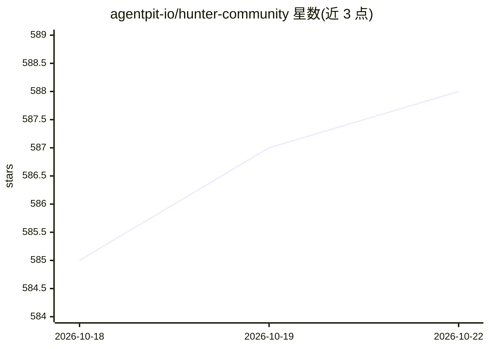

# agentpit-io/hunter-community

⭐ 588 · Python · Apache-2.0 · 推送 2026-10-14 · [GitHub](https://github.com/agentpit-io/hunter-community) · [官网](https://hunter-community.agentpit.io) · 组织维护 · 中文 README

**自部署多智能体投研助手：A股/港股/美股数据与本地对话分析**

HunterCode 社区版是 Docker Compose 自托管的金融 AI 投研终端，自称腾讯 WorkBuddy 金融版的开源本地替代（声明与腾讯无隶属关系）。提供实时行情、K线财报、龙虎榜、UZI 深度分析、Kronos 走势预测、全市场筛选与仅模拟盘的纸上交易账本；分析方法论以 Anthropic Agent Skills 格式的 SKILL 承载，内置 6 个并支持从 GitHub 安装。模型 BYOK（内置额度网关或自带 OpenAI 兼容 key），对话与持仓存本地 Postgres；不接券商实盘交易。面向会用 Docker 的个人投资者、私募研究员与小量化团队。

## 筛选速览

| 维度 | 判定 | 备注 |
|---|---|---|
| AI 角色 | `ai-native` | 本体是模型或模型工具 |
| 许可风险 | `permissive` | Apache-2.0 |
| 部署形态 | `desktop` | 安装包/桌面程序 |
| 模型依赖 | — | README 未给出锁定关系 |
| 硬件要求 | — | 无带数字的原话,不猜 |
| 安装摩擦 | `low` | 无编译、无系统依赖或容器化 |
| 成熟度 | `idea` | |

## 能力要点

- 六个服务 Docker Compose 自托管，数据与对话全部本地存储
- SKILL 采用 Anthropic Agent Skills 标准 Markdown 格式，内置 6 个可从 GitHub 安装
- 纸上交易账本仅模拟盘，账本角色无 UPDATE/DELETE 权限，Temporal 驱动调度
- 数据供给三选一：免费开源源（AKShare 等）/ 自接 MCP / 平台数据管道

## 适用场景

- 在自己服务器上跑一个行情查询与个股深度分析的投研助手
- 用 Markdown SKILL 把自己的分析方法论变成可复用的分析能力
- 用纸上交易账本跑策略模拟并查看每笔委托的四步链路

## 场景标签

`多智能体` `金融量化` · 领域:Agent 开发

## 证据(README 行号)

> L32: **它是什么** —— 一个跑在你自己电脑或服务器上的金融 AI 助手。你给它一个大模型 key,它就能查行情、拉新闻、做个股深度分析、预测走势、管理自选和持仓,并按你写的 SKILL(分析方法论)工作。对话、持仓、投资论点全部存
> L254: - Kronos 走势预测(清华时序模型)
> L26: 🏆 入围世界人工智能开源大赛(GOAI)总决赛 · 赛道二 TOP 15 · 与 WorkBuddy 金融版逐项对比(附官方来源) · 完整演示视频 3 分钟(2026-09-19 录制)

## 星数曲线

2026-10-18 585 → 2026-10-22 588（+3）

---
*卡片 v1 · prompt 1.4 · 生成 2026-10-21 · 置信度 high · 依据 README sha `92a429742b53` · [字段定义](../../DATASET.md)*
