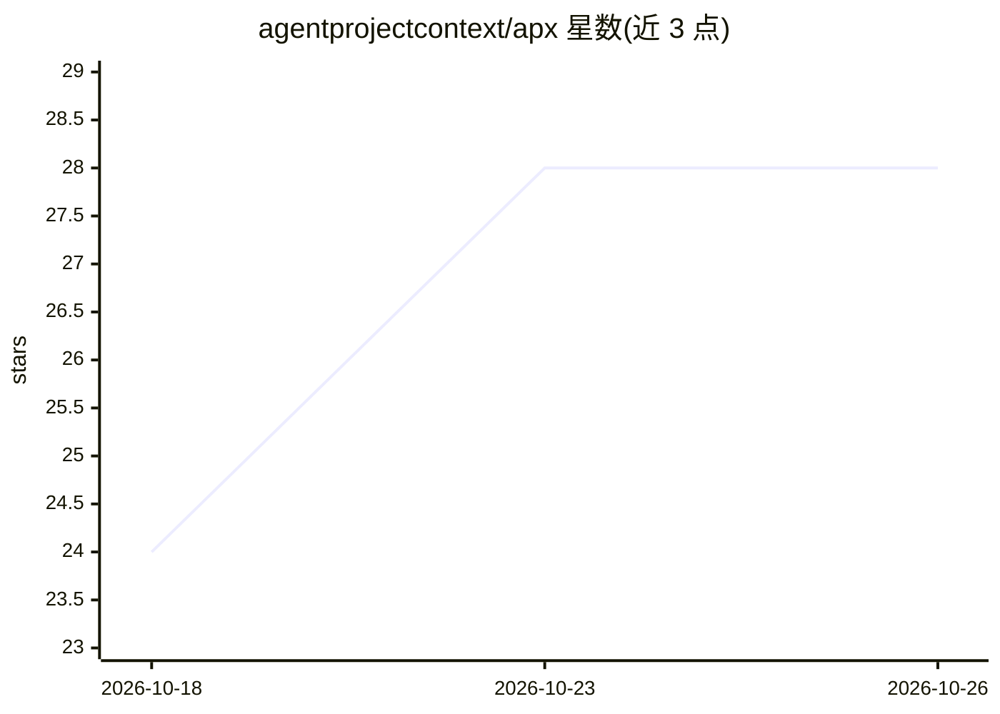

# agentprojectcontext/apx

⭐ 28 · JavaScript · MIT · 推送 2026-10-25 · [GitHub](https://github.com/agentprojectcontext/apx) · [官网](https://agentprojectcontext.github.io/apx/) · 组织维护

**本地运行的 Agent OS：自组多 AI agent 团队协同工作**

开源 Agent 操作系统，在本机运行一组 AI agent：为 agent 设定角色、记忆与工具，通过群聊、任务、定时例程让多个 agent 协作，支持网页面板、CLI、Telegram、WhatsApp、Android 客户端等多渠道访问。记忆以纯文本文件存储于本地 ~/.apx/。可连接模型提供商、本地 Ollama 模型与 MCP 服务器，编码任务可委托给 Claude Code、Codex 等 8 种外部 CLI 运行时。v1 需 Node.js 22+，通过 npm 安装；v2 处于 beta，提供桌面/手机应用与一键安装脚本。注意本地运行不等于所有模型离线运行。

## 筛选速览

| 维度 | 判定 | 备注 |
|---|---|---|
| AI 角色 | `ai-ecosystem` | LLM/agent 周边工具 |
| 许可风险 | `permissive` | MIT |
| 部署形态 | `library` | 以包/库形式分发 |
| 模型依赖 | local-ok | 支持本地模型 |
| 硬件要求 | — | 无带数字的原话,不猜 |
| 安装摩擦 | `low` | 无编译、无系统依赖或容器化 |
| 成熟度 | `idea` | |

## 能力要点

- 多 agent 团队协作：群聊、相互委托、定时例程
- 记忆以纯文本文件本地存储（~/.apx/ 与项目内 .apc/）
- 支持 Claude Code、Codex、OpenCode、Aider 等 8 种编码 CLI 运行时
- 多渠道接入：网页面板、CLI、Telegram、WhatsApp、Android 应用

## 适用场景

- 为研究、写作、日常计划或业务运营组建专属 agent 团队
- 通过 Telegram/WhatsApp 或手机面板随时指挥同一组 agent
- 把日报、简报等重复工作设为定时例程自动执行
- 将编码任务委托给本机已装的 Claude Code/Codex 等 CLI

## 场景标签

`多智能体` · 领域:Agent 开发

## 证据(README 行号)

> L10:  APX is an open-source Agent OS: your own team of AI agents, running on your machine.
> L43: - **Bring your models and tools.** Connect model providers, local Ollama models, skills and MCP servers. For coding
> L176: |`claude-code`|Spawns Claude Code CLI with the agent's system prompt injected|

## 星数曲线

2026-10-18 24 → 2026-10-26 28（+4）

---
*卡片 v1 · prompt 1.4 · 生成 2026-10-26 · 置信度 high · 依据 README sha `9293f73d7d6f` · [字段定义](../../DATASET.md)*
