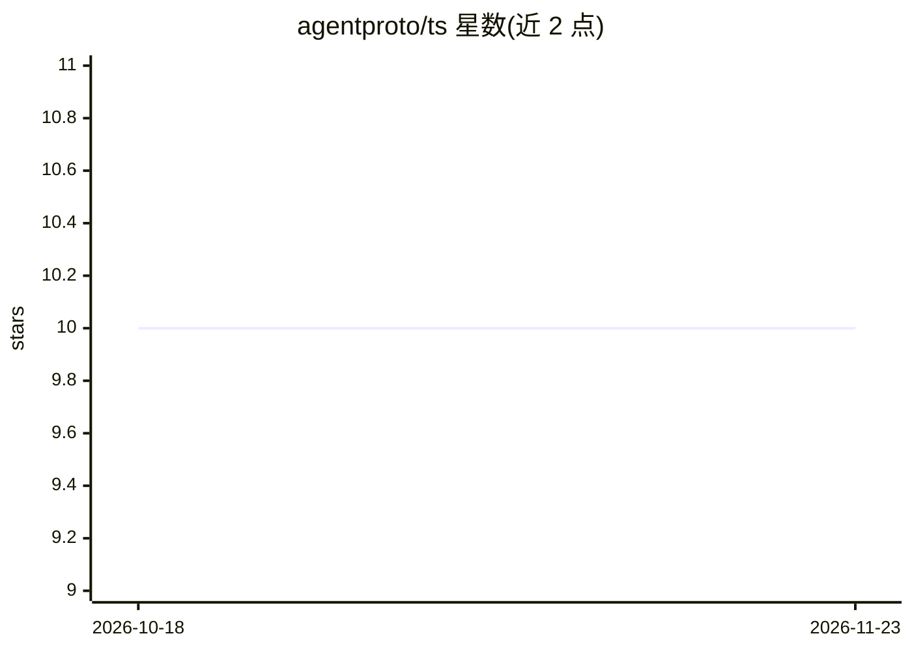

# agentproto/ts

⭐ 10 · TypeScript · Apache-2.0 · 推送 2026-11-22 · [GitHub](https://github.com/agentproto/ts) · [官网](https://agentproto.sh) · 组织维护

**TypeScript 编码 agent 运行时：后台托管会话并做门禁检查**

本地守护进程加 CLI，将 Claude Code、Codex、opencode 等编码 agent 作为后台会话启动、统一列表管理，支持在会话结束回合时运行测试或评审 agent 作为门禁，门禁失败可自动重试或标记 blocked，通过 commit 需人工确认。还提供工具/技能/工作流的文件化规范（AIP），并投影到 CLI、HTTP、MCP、Mastra、Vercel AI SDK 等宿主。通过 npm 安装 CLI，Node 24 运行；Tier 2 规范多数为早期脚手架，API 仍在稳定化中。

## 筛选速览

| 维度 | 判定 | 备注 |
|---|---|---|
| AI 角色 | `ai-ecosystem` | LLM/agent 周边工具 |
| 许可风险 | `permissive` | Apache-2.0 |
| 部署形态 | `library` | 以包/库形式分发 |
| 模型依赖 | — | README 未给出锁定关系 |
| 硬件要求 | — | 无带数字的原话,不猜 |
| 安装摩擦 | `low` | 无编译、无系统依赖或容器化 |
| 成熟度 | `idea` | |

## 能力要点

- 统一命令启动、消息、监视和停止多个编码 agent 会话
- 按会话附加门禁：shell 命令或评审 agent，失败可重试并需人工 ack 后才提交
- 会话可运行在用户自建云端沙箱（如 e2b）或本地
- 支持 MCP 服务器导入、浏览器驱动、隧道、cron 工作流等周边工具

## 适用场景

- 让多个编码 agent 在后台并行工作并集中查看会话状态
- 在 agent 改动合并前用测试套件自动把关
- 通过 MCP 客户端访问本地 agent 会话与工具

## 场景标签

`编码 Agent` · 领域:编码与开发

## 证据(README 行号)

> L6: agentproto is a local daemon plus a CLI. It starts coding agents such as Claude
> L164: `@agentproto/runtime` is the long-running gateway that turns a workspace into

## 星数曲线

2026-10-18 10 → 2026-11-23 10（+0）

---
*卡片 v1 · prompt 1.4 · 生成 2026-11-23 · 置信度 high · 依据 README sha `252c27645da4` · [字段定义](../../DATASET.md)*
