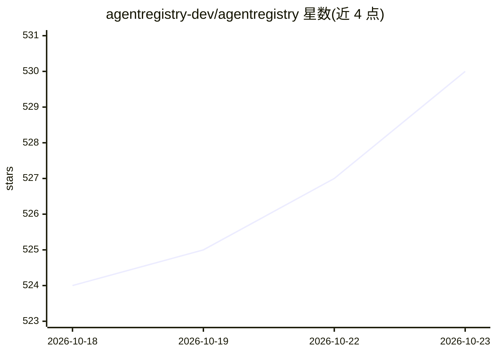

# agentregistry-dev/agentregistry

⭐ 530 · Go · Apache-2.0 · 推送 2026-10-16 · [GitHub](https://github.com/agentregistry-dev/agentregistry) · [官网](https://aregistry.ai) · 组织维护

**集中注册、治理与部署 MCP 服务器、AI agent 与技能的开源注册平台**

面向平台团队与开发者的 AI 构件注册中心：将分散在 npm、PyPI、Docker Hub、GitHub 的 MCP 服务器、agent、技能（SKILL.md 打包）与提示词统一发布到单一注册表，提供 arctl CLI 与本地 Web UI（localhost:12121）进行发现、版本管理、审核治理与一键部署；可生成 Claude Desktop、Cursor、VS Code 等客户端配置，并通过 Helm 部署到 Kubernetes，配合 agentgateway 作为 MCP 流量的反向代理与 LLM 网关。本产品以 Go 编写，Apache 2.0 许可，运行需 Docker Desktop 与 Docker Compose v2+。

## 筛选速览

| 维度 | 判定 | 备注 |
|---|---|---|
| AI 角色 | `ai-ecosystem` | LLM/agent 周边工具 |
| 许可风险 | `permissive` | Apache-2.0 |
| 部署形态 | `self-host` | docker 或自建部署 |
| 模型依赖 | — | README 未给出锁定关系 |
| 硬件要求 | — | 无带数字的原话,不猜 |
| 安装摩擦 | `low` | 无编译、无系统依赖或容器化 |
| 成熟度 | — | 结构信号不足 |

## 能力要点

- 统一注册 MCP 服务器、agent、技能与提示词，带版本与元数据治理
- arctl CLI 支持脚手架、构建、推送与 arctl run 本地运行
- 自动生成 Claude Desktop / Cursor / Kiro / VS Code 客户端配置
- 与 agentgateway 配对提供 MCP 反向代理、认证与 LLM 统一网关

## 适用场景

- 平台团队集中审核与分发组织内认可的 MCP 服务器和 agent 构件
- 开发者在团队内发现并一键拉取部署 AI 构件，减少手工 Docker 配置
- 统一本地开发与 Kubernetes 集群的构件交付流程

## 场景标签

 · 领域:AI 基础设施/registry

## 证据(README 行号)

> L20: agentregistry is an open-source platform that gives you one place to find, manage, and run MCP servers, AI agents, 
> L91: - Publish artifacts to a central registry from npm, PyPI, Docker, OCI, or remote endpoints
> L123: 1. Platform teams curate and publish approved MCP servers, agents, and skills in Agent Registry

## 星数曲线

2026-10-18 524 → 2026-10-23 530（+6）

---
*卡片 v1 · prompt 1.4 · 生成 2026-10-21 · 置信度 mid · 依据 README sha `09bb79cd71da` · [字段定义](../../DATASET.md)*
