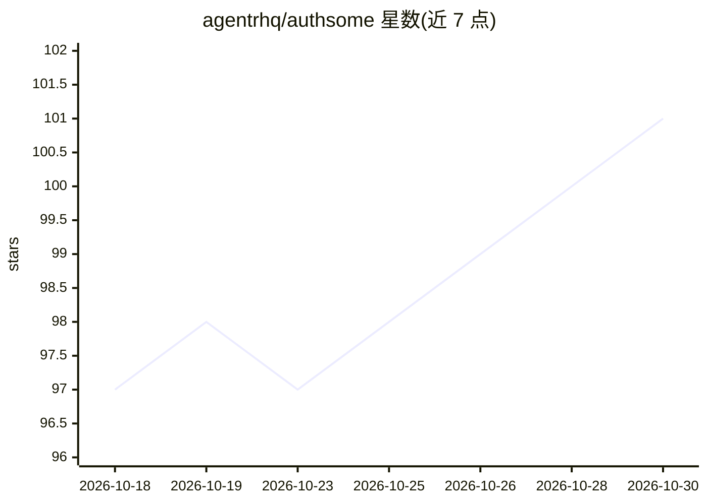

# agentrhq/authsome

⭐ 101 · Python · MIT · 推送 2026-07-24 · [GitHub](https://github.com/agentrhq/authsome) · [官网](https://authsome.ai/docs) · 组织维护

**AI agent 的凭证网关：一次登录，代理注入凭证**

位于 agent 与外部服务之间的开源凭证网关。用户通过 OAuth2 或 API key 登录一次，凭证加密存储并在过期前自动刷新；agent 通过 `authsome run --` 前缀命令经 HTTP 代理在请求时注入凭证头，凭证不进入子进程环境变量，agent 进程不接触原始凭证。提供 CLI 与 Docker 持久守护进程两种运行方式，并附 Claude Code、Codex、Cursor、LangChain、LlamaIndex 等适配器。要求 Python 3.13+，MIT 许可。

## 筛选速览

| 维度 | 判定 | 备注 |
|---|---|---|
| AI 角色 | `ai-ecosystem` | LLM/agent 周边工具 |
| 许可风险 | `permissive` | MIT |
| 部署形态 | `self-host` | docker 或自建部署 |
| 模型依赖 | — | README 未给出锁定关系 |
| 硬件要求 | — | 无带数字的原话,不猜 |
| 安装摩擦 | `low` | 无编译、无系统依赖或容器化 |
| 成熟度 | — | 结构信号不足 |

## 能力要点

- 凭证加密存储并在过期前自动刷新
- authsome run 经 HTTP 代理注入凭证头，agent 进程不接触凭证
- OAuth2 与 API key 双类内置 provider，支持每 provider 多账号
- 提供 Claude Code/Codex/Cursor/LangChain/LlamaIndex 等 agent 框架适配器

## 适用场景

- 在 CI、SSH、cron 等无交互环境中让 agent 持续访问外部 API
- 统一管理多个 agent 的 API 凭证并审计访问行为
- 避免在项目里硬编码长期有效的 token

## 场景标签

 · 领域:AI agent 基础设施/安全

## 证据(README 行号)

> L18: An open-source credential gateway that sits between your agents and the services they call. Instead of sharing cred
> L135: Authsome ships with adapters for the most common agent frameworks and CLIs:

## 星数曲线

2026-10-18 97 → 2026-10-30 101（+4）

---
*卡片 v1 · prompt 1.4 · 生成 2026-10-23 · 置信度 mid · 依据 README sha `61a0c7e36b5c` · [字段定义](../../DATASET.md)*
