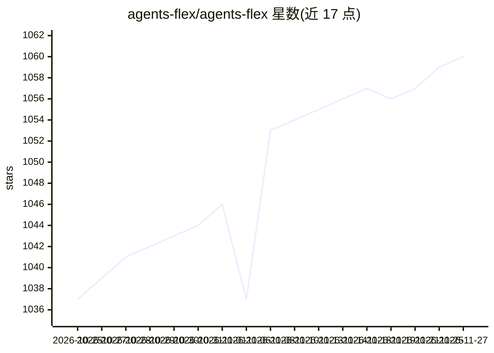

# agents-flex/agents-flex

⭐ 1,060 · Java · Apache-2.0 · 推送 2026-11-22 · [GitHub](https://github.com/agents-flex/agents-flex) · [官网](https://agentsflex.com) · 组织维护 · 中文 README

**Java 生态轻量级 AI 应用与 Agent 开发框架**

面向 Java 开发者的 LLM 应用开发框架，将 Chat/Embedding/Image/Audio/OCR 模型调用、Tool Calling、RAG、向量库、MCP、Skills、Text2SQL、LLM Wiki、Sub-agent 等能力拆分为 30 余个 Maven 模块，可按需组合；核心兼容 Java 8+，提供 Spring Boot starter 自动配置，并内置模型路由、重试、负载均衡、熔断与 OpenTelemetry 可观测性等面向生产环境的机制。适用于构建智能客服、企业知识库、自然语言数据分析与需要同时接入多家模型服务的 Java 服务。

## 筛选速览

| 维度 | 判定 | 备注 |
|---|---|---|
| AI 角色 | `ai-ecosystem` | LLM/agent 周边工具 |
| 许可风险 | `permissive` | Apache-2.0 |
| 部署形态 | `None` |  |
| 模型依赖 | local-ok | 支持本地模型 |
| 硬件要求 | — | 无带数字的原话,不猜 |
| 安装摩擦 | `medium` | 含编译或系统依赖之一 |
| 成熟度 | — | 结构信号不足 |

## 能力要点

- Java 8+ 原生兼容，30+ Maven 模块按需组合，提供 Spring Boot starter
- 统一 ChatModel/EmbeddingModel/ImageModel/RerankModel 抽象，同步与流式一致 API
- 持久化 Agent 运行时：快照恢复、工具审批、中间件与事件流
- 完整 RAG 构件：解析、切分、Embedding、9+ 种向量库与 Rerank

## 适用场景

- 在 Java/Spring Boot 服务中接入多家模型提供商
- 搭建企业知识库与 RAG 问答系统
- 构建带工具调用与审批的 Agent 工作流
- 自然语言转 SQL 的数据分析场景

## 场景标签

`RAG` `数据分析` `Agent 框架` · 领域:Agent 开发

## 证据(README 行号)

> L7: Agents-Flex is a lightweight AI application development framework for the Java ecosystem. It organizes LLM calls, To
> L17: - **Durable Agent runtime**: Provides snapshot recovery, tool approval, version-safe persistence, middleware, and e
> L32: |`agents-flex-chat`|Chat model integrations: OpenAI-compatible APIs, Qwen, Ollama, DeepSeek, LiteLLM, llmman|

## 星数曲线

2026-10-25 1,037 → 2026-11-27 1,060（+23）

---
*卡片 v1 · prompt 1.4 · 生成 2026-11-25 · 置信度 high · 依据 README sha `88a5d10b524c` · [字段定义](../../DATASET.md)*
