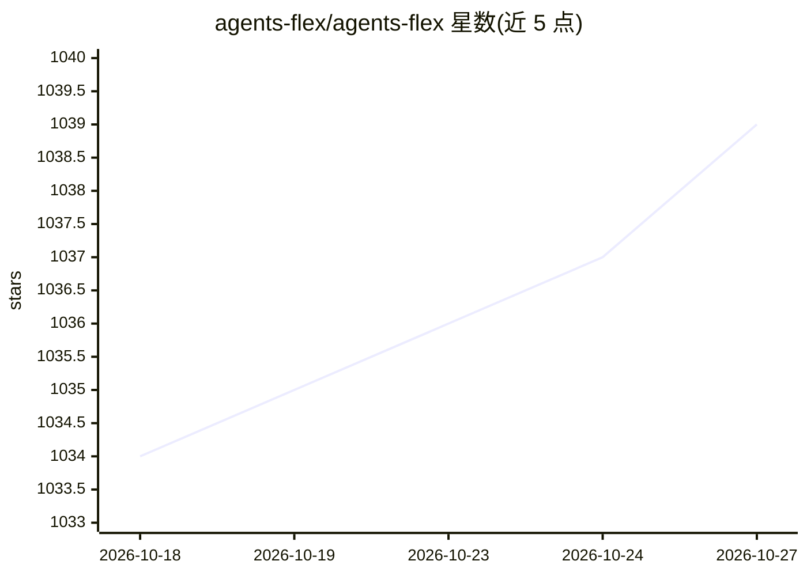

# agents-flex/agents-flex

⭐ 1,039 · Java · Apache-2.0 · 推送 2026-10-23 · [GitHub](https://github.com/agents-flex/agents-flex) · [官网](https://agentsflex.com) · 组织维护 · 中文 README

**面向 Java 开发者的轻量级 AI Agent 开发框架**

Java 生态的 AI 应用开发框架，将 LLM 调用、Tool Calling、RAG、Embedding、向量存储、MCP、Skills、Text2SQL、Sub-agent、Web 搜索、LLM Wiki 等能力组织为可按需组合的 Maven 模块，核心模块兼容 Java 8+，可运行于纯 Java 或 Spring Boot。提供统一模型抽象（ChatModel/EmbeddingModel 等）、同步与流式一致 API、持久化 Agent 运行时（快照恢复、审批）、模型路由/重试/熔断与 OpenTelemetry 观测。支持 OpenAI 兼容 API、Qwen、Ollama、DeepSeek 等多种模型接入，版本 2.3.0，通过 Maven 依赖安装。

## 筛选速览

| 维度 | 判定 | 备注 |
|---|---|---|
| AI 角色 | `ai-ecosystem` | LLM/agent 周边工具 |
| 许可风险 | `permissive` | Apache-2.0 |
| 部署形态 | `None` |  |
| 模型依赖 | local-ok | 支持本地模型 |
| 硬件要求 | — | 无带数字的原话,不猜 |
| 安装摩擦 | `medium` | 含编译或系统依赖之一 |
| 成熟度 | — | 结构信号不足 |

## 能力要点

- 统一模型抽象（ChatModel/EmbeddingModel/ImageModel/RerankModel）与一致的同步/流式 API
- 持久化 Agent 运行时：快照恢复、工具审批、事件流
- 完整 RAG 构件：文档解析、切分、Embedding、10 种向量存储、Rerank
- MCP 客户端（stdio/http-sse/http-stream）将外部 MCP 工具转为 Tool 实例

## 适用场景

- 在 Java/Spring Boot 服务中构建智能客服或企业知识库
- 用自然语言做数据分析（Text2SQL，含只读检查）
- 编排带工具调用、审批与子代理的 Agent 工作流
- 同一服务接入多家模型供应商并做路由与熔断

## 场景标签

`RAG` `Agent 框架` · 领域:Agent 开发

## 证据(README 行号)

> L7: Agents-Flex is a lightweight AI application development framework for the Java ecosystem. It organizes LLM calls, To
> L9: It is suitable for building intelligent customer service, enterprise knowledge bases, natural-language data analysis

## 星数曲线

2026-10-18 1,034 → 2026-10-27 1,039（+5）

---
*卡片 v1 · prompt 1.4 · 生成 2026-10-21 · 置信度 high · 依据 README sha `55035908f948` · [字段定义](../../DATASET.md)*
