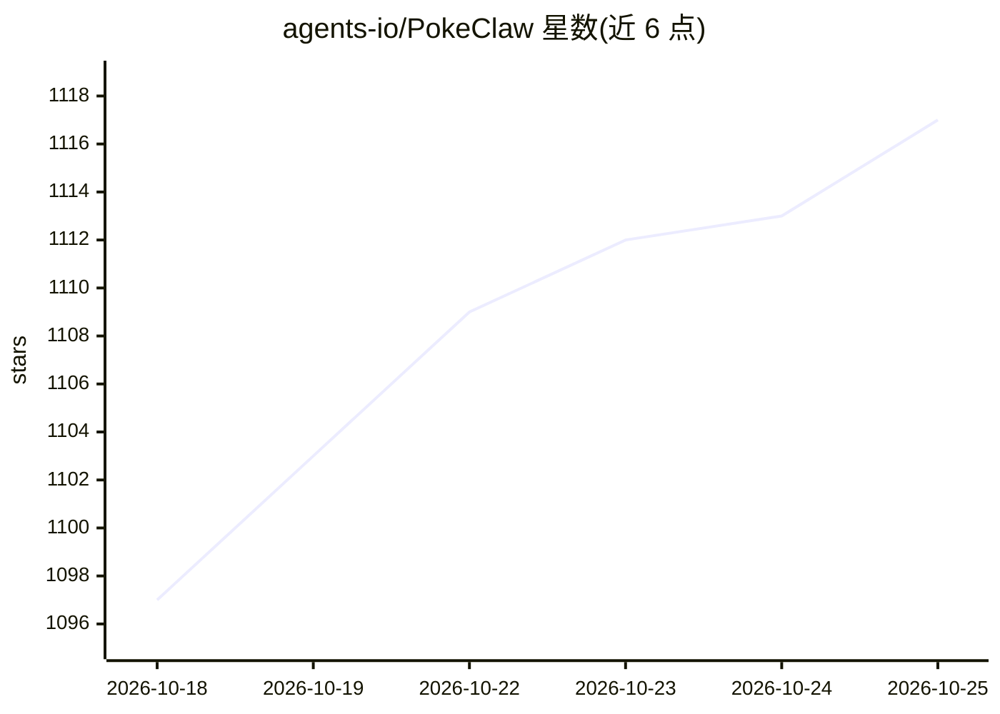

# agents-io/PokeClaw

⭐ 1,117 · Kotlin · Apache-2.0 · 推送 2026-06-02 · [GitHub](https://github.com/agents-io/PokeClaw) · 个人维护

**端侧 Gemma 4 驱动的 Android 手机 AI 自动化应用**

开源 Android 应用，在手机上本地运行 Gemma 4（经 LiteRT-LM，原生 tool calling），由模型读取屏幕文本表示、自主选择工具（tap/swipe/input_text/send_message 等）完成跨应用操作；Local 模式无需账号或 API key，也支持可选云端模型处理更复杂任务。含 WhatsApp 联系人监控自动回复、通知摘要、剪贴板解释等任务，已在 Pixel 8 Pro 上做真机 QA（本地 quick-task 4/4，云端 GPT-4.1 18/20）。当前公开版本自述为 local-first 原型，纯 CPU 设备冷启动较慢（约 45 秒至 2 分多钟）。

## 筛选速览

| 维度 | 判定 | 备注 |
|---|---|---|
| AI 角色 | `ai-native` | 本体是模型或模型工具 |
| 许可风险 | `permissive` | Apache-2.0 |
| 部署形态 | `None` |  |
| 模型依赖 | — | README 未给出锁定关系 |
| 硬件要求 | — | 无带数字的原话,不猜 |
| 安装摩擦 | `low` | 无编译、无系统依赖或容器化 |
| 成熟度 | `idea` | |

## 能力要点

- 本地 Gemma 4 经 LiteRT-LM 运行，Local 模式无需账号或 API key
- 9 个通用工具（tap/swipe/input_text/send_message/auto_reply 等）由模型自主选择与串联
- 支持可选云端模型执行更强任务，同一 harness 下本地/云端可切换
- 真机 QA 数据：Pixel 8 Pro 上本地 quick-task 4/4，云端 GPT-4.1 18/20

## 适用场景

- 让 AI 在手机上代我发消息、装应用、查设置等跨应用操作
- 监控指定联系人并用本地模型按上下文自动回复 WhatsApp
- 在不联网、不配 API key 的前提下让 AI 读取屏幕并完成手机任务

## 场景标签

`GUI 自动化` · 领域:效率与自动化

## 证据(README 行号)

> L13: It can run Gemma 4 on-device for local, private phone control, and it also supports optional cloud models when you 
> L192: PokeClaw gives a small on-device LLM a set of tools (tap, swipe, type, open app, send message, enable auto-reply, 
> L194: Local execution runs via LiteRT-LM with native tool calling. In Local mode, the model runs on-device.

## 星数曲线

2026-10-18 1,097 → 2026-10-25 1,117（+20）

---
*卡片 v1 · prompt 1.4 · 生成 2026-10-21 · 置信度 high · 依据 README sha `592fc96701bb` · [字段定义](../../DATASET.md)*
