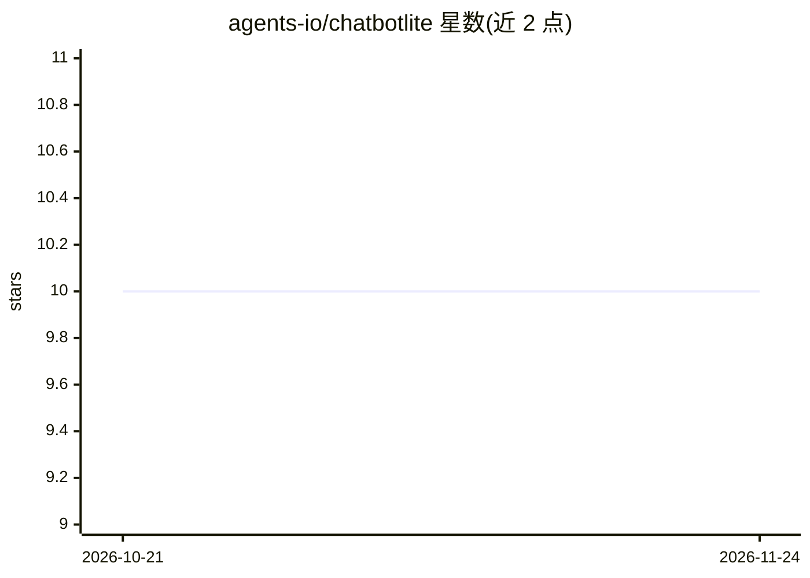

# agents-io/chatbotlite

⭐ 10 · TypeScript · Apache-2.0 · 推送 2026-05-31 · [GitHub](https://github.com/agents-io/chatbotlite) · [官网](https://chatbotlite-demos.vercel.app) · 个人维护

**3 行代码为网站接入 AI 聊天机器人的 SDK 与 React 挂件**

面向独立开发者与中小企业的嵌入式聊天机器人 SDK：React 组件或 <script> 标签接入，服务端提供 ChatBot 类与 Markdown 知识文件（无向量数据库）。支持多供应商密钥的自动故障转移链（流式中途报错切到下一个供应商）、13 个仅凭 URL 的适配器（支付/预约/表单收集）、[SKILL] 标记渲染内联工具卡片、可插拔会话存储。提供 chatbotlite-mcp MCP 服务器供 AI 编码代理一键搭建。Apache 2.0，无 SaaS 订阅。

## 筛选速览

| 维度 | 判定 | 备注 |
|---|---|---|
| AI 角色 | `ai-ecosystem` | LLM/agent 周边工具 |
| 许可风险 | `permissive` | Apache-2.0 |
| 部署形态 | `library` | 以包/库形式分发 |
| 模型依赖 | local-ok | 支持本地模型 |
| 硬件要求 | — | 无带数字的原话,不猜 |
| 安装摩擦 | `low` | 无编译、无系统依赖或容器化 |
| 成熟度 | — | 结构信号不足 |

## 能力要点

- 3 行代码接入，提供 React 组件与纯 HTML script 两种方式
- 10 个托管 LLM 供应商自动故障转移，支持自定义 Ollama/LM Studio/vLLM 本地后端
- 13 个仅凭 URL 的适配器（Stripe、PayPal、Calendly 等），零后端零 API key
- Markdown 知识文件与内置防幻觉守卫，含 chatbotlite-mcp 脚手架服务器

## 适用场景

- 给电商、诊所、餐厅等中小企业网站快速加客服聊天挂件
- 在聊天中内联触发支付、预约回调、文件上传等操作
- 已运行本地模型的场景下搭建数据不出本机的聊天机器人

## 场景标签

`聊天机器人` · 领域:对话与助手

## 证据(README 行号)

> L5:  AI chatbot in 3 lines of code.
> L30: import { ChatWidget } from "chatbotlite/react";
> L47: import { ChatBot } from "chatbotlite/client";

## 星数曲线

2026-10-21 10 → 2026-11-24 10（+0）

---
*卡片 v1 · prompt 1.4 · 生成 2026-11-20 · 置信度 high · 依据 README sha `208529481246` · [字段定义](../../DATASET.md)*
