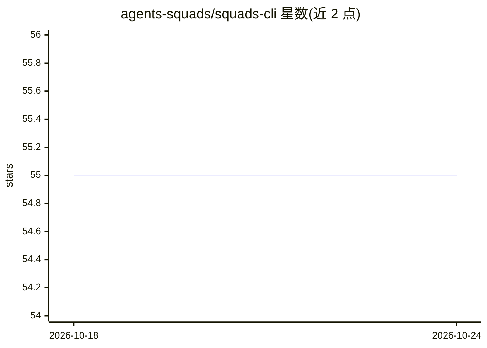

# agents-squads/squads-cli

⭐ 55 · TypeScript · MIT · 推送 2026-10-21 · [GitHub](https://github.com/agents-squads/squads-cli) · [官网](https://agents-squads.com) · 组织维护

**终端里管理 AI agent 小队的 CLI，markdown 定义、git 跟踪**

面向运行自治 AI agent 团队的命令行工具：一个小队由不同模型与角色的 agent 组成，含 lead/worker/verifier 角色与逐周期反馈注入，共享持久记忆。所有状态均为 git 仓库中的 markdown 文件，无数据库与服务器。通过调用本机原生 AI CLI（claude、gemini、aider、opencode 等）组成混合模型小队。默认本地运行，需 Node.js >= 20、Git 与 Claude Code（默认 provider）。安装方式为 npm 全局安装。

## 筛选速览

| 维度 | 判定 | 备注 |
|---|---|---|
| AI 角色 | `ai-ecosystem` | LLM/agent 周边工具 |
| 许可风险 | `permissive` | MIT |
| 部署形态 | `library` | 以包/库形式分发 |
| 模型依赖 | — | README 未给出锁定关系 |
| 硬件要求 | — | 无带数字的原话,不猜 |
| 安装摩擦 | `low` | 无编译、无系统依赖或容器化 |
| 成熟度 | — | 结构信号不足 |

## 能力要点

- markdown 文件定义小队，git 作为状态与审计轨迹
- 调用原生 AI CLI 组成混合模型团队（扫描/构建/校验分角色）
- 运行前加载 context cascade（战略、目标、反馈、团队动态）
- squads inbox 汇总待人批准事项，squads doctor 检查环境

## 适用场景

- 在终端组建工程、市场、财务、运营等领域的多 agent 团队
- 用不同价位模型分工协作（扫描/构建/校验）完成小队任务
- 以 git 仓库审计和回溯 agent 的工作与反馈循环

## 场景标签

`多智能体` `Agent 框架` · 领域:Agent 开发

## 证据(README 行号)

> L14: A **squad** is a team of AI agents — different models, different roles —
> L56: Squads shells out to native AI CLIs (`claude`, `gemini`, `aider`, `opencode`, …), so
> L79: Node.js >= 20, Git, and

## 星数曲线

2026-10-18 55 → 2026-10-24 55（+0）

---
*卡片 v1 · prompt 1.4 · 生成 2026-10-24 · 置信度 high · 依据 README sha `4674b5797b3a` · [字段定义](../../DATASET.md)*
