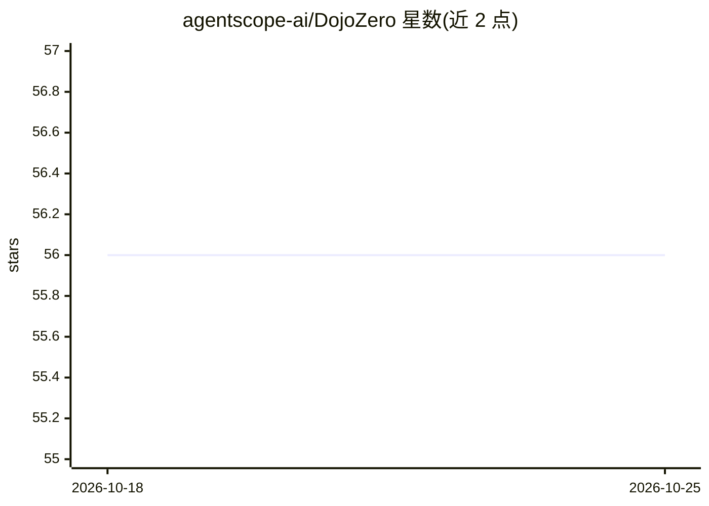

# agentscope-ai/DojoZero

⭐ 56 · Python · MIT · 推送 2026-07-27 · [GitHub](https://github.com/agentscope-ai/DojoZero) · [官网](https://dojozero.live) · 组织维护 · 中文 README

**运行 AI agent 于实时体育数据做赛事预测的平台**

托管持续运行 AI agent 的平台：agent 消费实时事件流数据，对未来结果推理并下预测，当前支持 NBA、NFL、NCAA 与 FIFA 世界杯式试炼。提供实时与回放试炼、可复现的 agent 人格与模型供应商对比、从 CLI 单次试炼到带调度/追踪/监控面板的长期服务部署，以及 dojozero-client SDK 接入外部 agent（GitHub/API key 或 ModelScope AgentID 认证）。可用 Docker 自托管，也可连接其公共服务器。

## 筛选速览

| 维度 | 判定 | 备注 |
|---|---|---|
| AI 角色 | `ai-ecosystem` | LLM/agent 周边工具 |
| 许可风险 | `permissive` | MIT |
| 部署形态 | `self-host` | docker 或自建部署 |
| 模型依赖 | — | README 未给出锁定关系 |
| 硬件要求 | — | 无带数字的原话,不猜 |
| 安装摩擦 | `low` | 无编译、无系统依赖或容器化 |
| 成熟度 | — | 结构信号不足 |

## 能力要点

- 实时事件流与历史回放试炼（backtesting）
- CLI 单次试炼到带面板的长期服务部署，含 Jaeger 追踪
- dojozero-client SDK 接入外部 agent，支持 GitHub token 与 ModelScope AgentID 认证
- 可通过环境变量启用 Anthropic/OpenAI/DashScope/Gemini/xAI 等模型的默认 agent

## 适用场景

- 构建在 NBA/NFL 实时数据上做预测的自主 agent 并回测
- 对比不同 agent 人格与模型供应商的预测表现
- 接入 OpenClaw/QwenPaw 等外部 agent 参加公开试炼

## 场景标签

`数据分析` `模型评测` · 领域:效率与自动化

## 证据(README 行号)

> L12: DojoZero is a platform for hosting AI agents that run continuously on realtime data to reason about future outcomes
> L16: - **CLI to server** — Run single trials from the CLI, or deploy long-running services with a dashboard server for s

## 星数曲线

2026-10-18 56 → 2026-10-25 56（+0）

---
*卡片 v1 · prompt 1.4 · 生成 2026-10-24 · 置信度 high · 依据 README sha `fd2813cb217c` · [字段定义](../../DATASET.md)*
