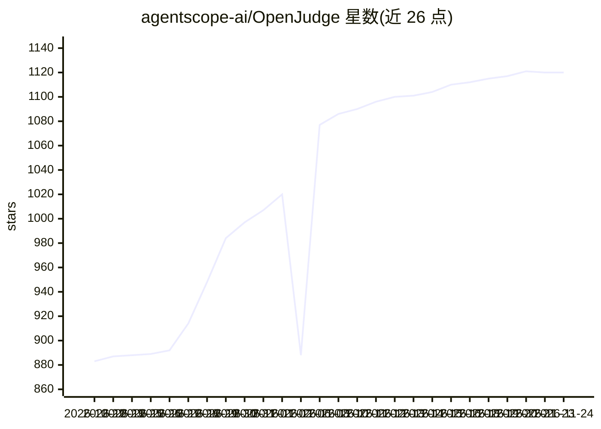

# agentscope-ai/OpenJudge

⭐ 1,120 · Python · Apache-2.0 · 推送 2026-11-21 · [GitHub](https://github.com/agentscope-ai/OpenJudge) · [官网](https://openjudge.me/) · 组织维护 · 中文 README

**面向 AI 应用的评测框架：提供 grader 库与奖励信号**

OpenJudge 是面向 AI 应用（如 agent、聊天机器人）的开源评测框架，提供 50+ 内置 grader，覆盖语义质量、Agent 生命周期、多模态等场景；支持通过 Python 接口、Prompt 模板、零样本/数据驱动方式生成场景化 rubric，也可训练专用 Judge Model。评测结果可转换为奖励信号，并可与 LangSmith、Langfuse 观测平台及 VERL 训练框架集成。以 PyPI 包形式分发（py-openjudge），另有在线 playground 与 Streamlit UI；v0.2.0 不向后兼容旧包 rm-gallery。

## 筛选速览

| 维度 | 判定 | 备注 |
|---|---|---|
| AI 角色 | `ai-ecosystem` | LLM/agent 周边工具 |
| 许可风险 | `permissive` | Apache-2.0 |
| 部署形态 | `library` | 以包/库形式分发 |
| 模型依赖 | — | README 未给出锁定关系 |
| 硬件要求 | — | 无带数字的原话,不猜 |
| 安装摩擦 | `low` | 无编译、无系统依赖或容器化 |
| 成熟度 | — | 结构信号不足 |

## 能力要点

- 50+ 内置 grader，覆盖 Agent、文本、代码、数学与多模态场景
- 支持零样本与数据驱动的 rubric 自动生成及 Judge Model 训练
- 可转换为奖励信号用于 RL 微调，集成 VERL/LangSmith/Langfuse
- 附带 PawBench 基准与在线 playground

## 适用场景

- 评测电商客服 agent 的相关性、幻觉与工具选择表现
- 为自有业务场景快速生成评测 rubric/grader
- 将 grader 结果作为奖励信号接入 RL 训练流程
- 在观测平台中对 LLM 应用做自动化评测

## 场景标签

`模型评测` `多模态` `强化学习` · 领域:评测与运维

## 证据(README 行号)

> L16: OpenJudge is an **open-source evaluation framework** for **AI applications** (e.g., AI agents or chatbots) designed
> L20: OpenJudge provides **ready-to-use graders** and supports generating **scenario-specific rubrics (as graders)**, mak
> L94: Using mainstream observability platforms like **LangSmith** or **Langfuse**? We offer seamless integration to enhan

## 星数曲线

2026-10-22 883 → 2026-11-24 1,120（+237）

---
*卡片 v1 · prompt 1.4 · 生成 2026-11-24 · 置信度 high · 依据 README sha `9bcc1316fd2c` · [字段定义](../../DATASET.md)*
