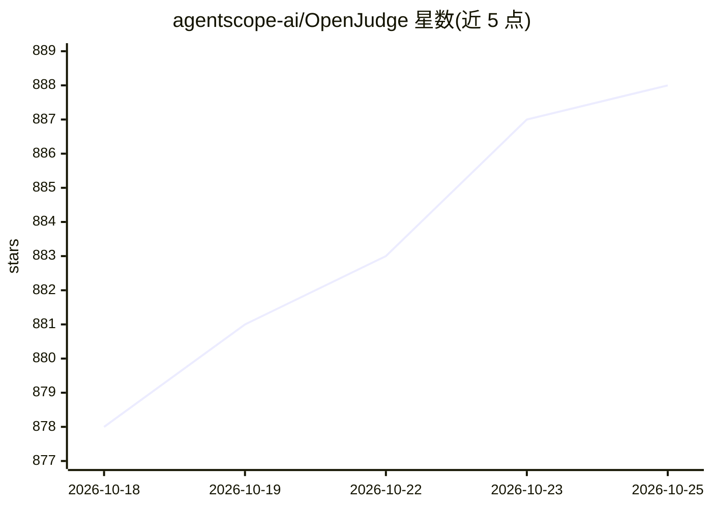

# agentscope-ai/OpenJudge

⭐ 888 · Python · Apache-2.0 · 推送 2026-10-20 · [GitHub](https://github.com/agentscope-ai/OpenJudge) · [官网](https://openjudge.me/) · 组织维护 · 中文 README

**面向 AI 应用与 Agent 的开源评测框架，提供 50+ 评分器**

面向 AI 应用（Agent、聊天机器人）的开源评测框架：提供 50+ 内置 grader 覆盖相关性、幻觉、Agent 生命周期（工具选择/记忆/轨迹）、多模态等维度，支持从任务描述零样本生成评分 rubric、从标注数据学习 rubric、以及训练专用 Judge 模型；评分结果可转换为奖励信号用于微调，并提供 LangSmith/Langfuse/VERL 集成。配套 PawBench 基准（150 任务×9 模型×3 harness）。以 pip 包 py-openjudge 分发，v0.2.0 与旧包 rm-gallery 不向后兼容。

## 筛选速览

| 维度 | 判定 | 备注 |
|---|---|---|
| AI 角色 | `ai-ecosystem` | LLM/agent 周边工具 |
| 许可风险 | `permissive` | Apache-2.0 |
| 部署形态 | `library` | 以包/库形式分发 |
| 模型依赖 | — | README 未给出锁定关系 |
| 硬件要求 | — | 无带数字的原话,不猜 |
| 安装摩擦 | `low` | 无编译、无系统依赖或容器化 |
| 成熟度 | — | 结构信号不足 |

## 能力要点

- 50+ 内置 grader，覆盖通用、Agent、多模态场景
- 零样本/数据驱动 rubric 生成与 Judge 模型训练管线
- 评分结果转换为奖励信号用于微调，集成 VERL 训练框架
- 在线平台 openjudge.me/app 可免安装测试 grader

## 适用场景

- 为电商客服 Agent 等业务场景做多维度自动评测
- 缺少标注数据时快速生成场景化评分标准
- 将评测结果转为奖励信号用于 RL 微调

## 场景标签

`模型评测` `强化学习` · 领域:评测与运维

## 证据(README 行号)

> L16: OpenJudge is an **open-source evaluation framework** for **AI applications** (e.g., AI agents or chatbots) designed
> L21: It can also convert grading results into **reward signals** to help you **fine-tune** and optimize your application
> L92: Using mainstream observability platforms like **LangSmith** or **Langfuse**? We offer seamless integration to enhan

## 星数曲线

2026-10-18 878 → 2026-10-25 888（+10）

---
*卡片 v1 · prompt 1.4 · 生成 2026-10-21 · 置信度 high · 依据 README sha `016327bb597a` · [字段定义](../../DATASET.md)*
