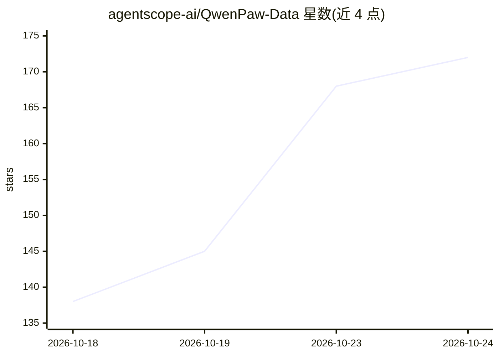

# agentscope-ai/QwenPaw-Data

⭐ 172 · Python · Apache-2.0 · 推送 2026-10-19 · [GitHub](https://github.com/agentscope-ai/QwenPaw-Data) · 组织维护 · 中文 README

**面向企业数据分析的 agentic 数据系统：事实治理+方法复用+可控执行**

QwenPaw-Data 将企业数据分析组织为三个子系统：DataBridge 把仓库、看板、文档、日志等异构资产整合为受治理的元数据图/知识图/轨迹图语义底座；Skill-Hub 管理可复用的路由、规划、工作流与原子分析技能；Host 负责 DAG 规划、子代理派发、工具调用（SQL/Python/文件/报告）、容器工作区执行与产物登记，把自然语言请求转为数据理解、检索、分析、报告生成的端到端流程。通过 CLI、headless HTTP/SSE 引擎、DataBridge 管理界面及 QwenPaw App 预览四种方式访问；PyPI 发布 Python 包，本地运行需 Git/uv/Node.js/Docker，默认 OpenAI 兼容接口（DashScope/qwen 模型），当前为 0.3.x 版本。

## 筛选速览

| 维度 | 判定 | 备注 |
|---|---|---|
| AI 角色 | `ai-native` | 本体是模型或模型工具 |
| 许可风险 | `permissive` | Apache-2.0 |
| 部署形态 | `self-host` | docker 或自建部署 |
| 模型依赖 | — | README 未给出锁定关系 |
| 硬件要求 | — | 无带数字的原话,不猜 |
| 安装摩擦 | `low` | 无编译、无系统依赖或容器化 |
| 成熟度 | `idea` | |

## 能力要点

- 三子系统架构：DataBridge 语义底座、Skill-Hub 方法编排、Host DAG 执行控制
- 元数据图/知识图/轨迹图的受治理分析上下文
- 自然语言请求转端到端工作流：检索、异常检测、归因、报告生成
- CLI / headless SSE 引擎 / DataBridge UI / QwenPaw App 多种访问模式

## 适用场景

- 业务指标监控与异常诊断（定位区域/渠道/细分驱动因素）
- 周期性经营报告从取数到决策文档的自动生成
- 开放式业务问题的多维拆解与贡献归因分析
- 对话与行为日志中挖掘用户意图与需求演变

## 场景标签

`数据分析` · 领域:效率与自动化

## 证据(README 行号)

> L11: **QwenPaw-Data is an agentic data system built for enterprise data analysis.**
> L15: QwenPaw-Data organizes its system design around three core dimensions: **facts**, **methodology**, and **execution*
> L39: The design principle of QwenPaw-Data is to decompose enterprise data analysis according to the core questions an AI

## 星数曲线

2026-10-18 138 → 2026-10-24 172（+34）

---
*卡片 v1 · prompt 1.4 · 生成 2026-10-23 · 置信度 mid · 依据 README sha `766ea7e5cad2` · [字段定义](../../DATASET.md)*
