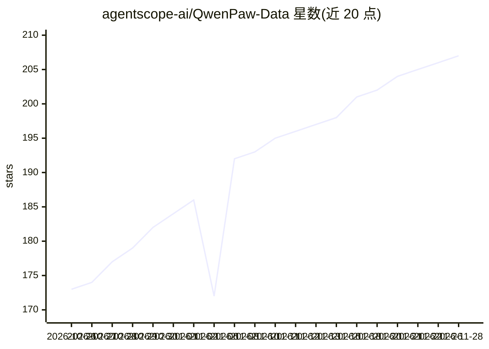

# agentscope-ai/QwenPaw-Data

⭐ 207 · Python · Apache-2.0 · 推送 2026-11-24 · [GitHub](https://github.com/agentscope-ai/QwenPaw-Data) · 组织维护 · 中文 README

**面向企业数据团队的自然语言数据分析 agent 系统**

由四个子系统组成的本地可部署数据 agent 系统：DataBridge 管理元数据图、知识图与业务语义，Skill-Hub 沉淀可复用的分析技能与方法，Host 将技能实例化为 DAG 执行图并管理工具调用、人工介入与产物登记，User Attention Loop 通过 Self-Judge 与反馈回路实现自我评估与经验沉淀。以 Python + uv 单仓库发布于 PyPI，含浏览器 Console、CLI、Headless HTTP/SSE 引擎等接入方式；本地安装无需登录或账号，源码安装需 Node.js 与 Docker。

## 筛选速览

| 维度 | 判定 | 备注 |
|---|---|---|
| AI 角色 | `ai-native` | 本体是模型或模型工具 |
| 许可风险 | `permissive` | Apache-2.0 |
| 部署形态 | `self-host` | docker 或自建部署 |
| 模型依赖 | — | README 未给出锁定关系 |
| 硬件要求 | — | 无带数字的原话,不猜 |
| 安装摩擦 | `low` | 无编译、无系统依赖或容器化 |
| 成熟度 | — | 结构信号不足 |

## 能力要点

- DataBridge 元数据图+知识图+用户图构成的受管语义底座
- Skill-Hub 提供路由、规划到原子分析操作的复用技能
- Host 生成 DAG 执行图，支持并行分支、人工介入与产物恢复
- Self-Judge + Feedback Loop 将执行轨迹转化为技能与语义更新

## 适用场景

- 用自然语言让 agent 完成从取数到报告的全流程业务分析
- 监控 DAU、营收等核心指标并定位异常波动的归因
- 管理企业数据源的语义配置与血缘图谱
- 通过 Headless API 把分析能力集成到自有前端或系统

## 场景标签

`数据分析` `知识图谱` · 领域:效率与自动化

## 证据(README 行号)

> L11: **QwenPaw-Data is an agentic data system built for enterprise data analysis.**
> L17: QwenPaw-Data organizes its system design around three core dimensions: **facts**, **methodology**, and **execution*
> L60: |**DataBridge**|Evidence grounding|Metadata, business knowledge, user context, metric definitions, data lineage, an

## 星数曲线

2026-10-26 173 → 2026-11-28 207（+34）

---
*卡片 v1 · prompt 1.4 · 生成 2026-11-26 · 置信度 mid · 依据 README sha `80cafefb816e` · [字段定义](../../DATASET.md)*
