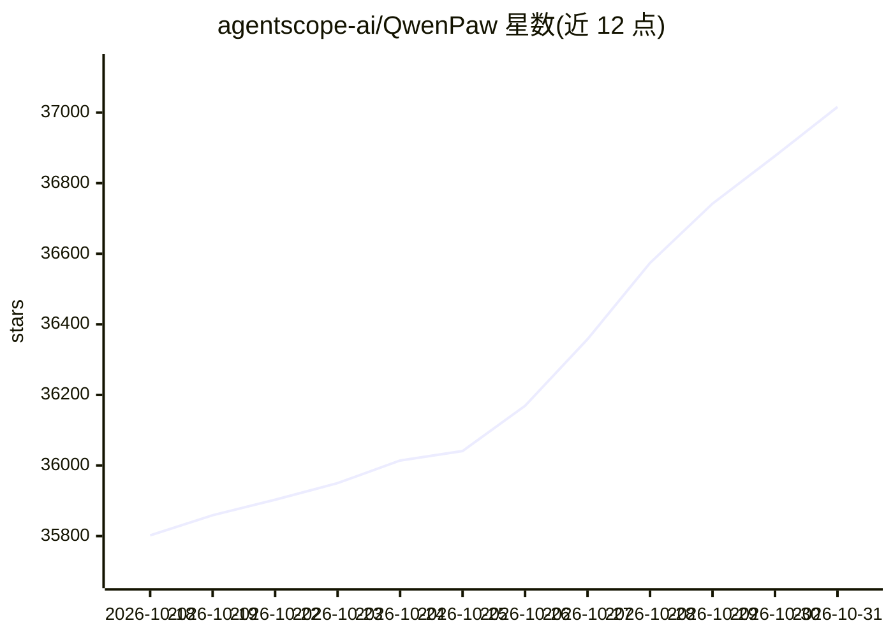

# agentscope-ai/QwenPaw

⭐ 37,016 · TypeScript · Apache-2.0 · 推送 2026-10-30 · [GitHub](https://github.com/agentscope-ai/QwenPaw) · [官网](http://qwenpaw.agentscope.io/) · 组织维护 · 中文 README

**可自托管部署的个人 AI 助手，多渠道接入**

面向个人用户的 AI 助手，可部署在本地或云端。采用三层记忆机制（工作上下文、完整历史、基于 ReMe 的个人知识库），内置 QwenPaw-Flash 系列模型（2B–35B-A3B），也可接入 Ollama、LM Studio 或 14+ 云端模型服务。支持 DingTalk、Lark、WeChat、Discord、Telegram、iMessage、QQ 等多渠道接入，以及 Console、TUI、桌面应用访问。扩展能力包括 Skills、Plugin 市场、MCP 集成、多 Agent 并行与 ACP 协议编排。安全机制含沙箱、Tool Guard、File Guard、Skill Scanner 与访问策略。

## 筛选速览

| 维度 | 判定 | 备注 |
|---|---|---|
| AI 角色 | `ai-native` | 本体是模型或模型工具 |
| 许可风险 | `permissive` | Apache-2.0 |
| 部署形态 | `desktop` | 安装包/桌面程序 |
| 模型依赖 | local-ok | 支持本地模型 |
| 硬件要求 | — | 无带数字的原话,不猜 |
| 安装摩擦 | `low` | 无编译、无系统依赖或容器化 |
| 成熟度 | `idea` | |

## 动量与使用信号

- 维护:`active` — 距上次 push 2.0 天,年发版 100,246 位贡献者
- 涨星:近 1 天 **+60**(自 20261016 起算)
- 安装:pypi 包 `qwenpaw` 月下载 15,362
- 平台:— · 协议:MCP / OLLAMA

## 能力要点

- 三层记忆：工作上下文、全量历史、自演化个人知识库（ReMe）
- 内置 QwenPaw-Flash 模型，本地运行无需 API key；兼容 Ollama/LM Studio/14+ 云服务
- 多渠道接入：DingTalk/Lark/WeChat/Discord/Telegram/iMessage/QQ 单实例全覆盖
- Kernel 级沙箱、Tool Guard、Skill Scanner 等安全机制

## 适用场景

- 本地部署一个数据不出机器的个人 AI 助手
- 把新闻摘要、报告生成等定时任务推送到多个聊天渠道
- 通过 Skills/插件/MCP 扩展专属工作流
- 在代码项目里进行文件读写、审查与测试

## 场景标签

`AI 助手` `聊天机器人` · 领域:对话与助手

## 证据(README 行号)

> L26: Your personal AI assistant — deploy locally or in the cloud, extend with Skills & Plugins, connect across every cha
> L31: |**Local or cloud, runs free**|QwenPaw-Flash models (2B / 4B / 9B / 35B-A3B / 27B) trained for agent tasks. Built-i
> L36: |**Reachable anywhere**|DingTalk, Lark, WeChat, Discord, Telegram, iMessage, QQ — one instance, all channels. Conso

## 星数曲线

2026-10-18 35,802 → 2026-10-31 37,016（+1,214）

---
*卡片 v1 · prompt 1.4 · 生成 2026-10-18 · 置信度 high · 依据 README sha `87bc1bf669d3` · [字段定义](../../DATASET.md)*
