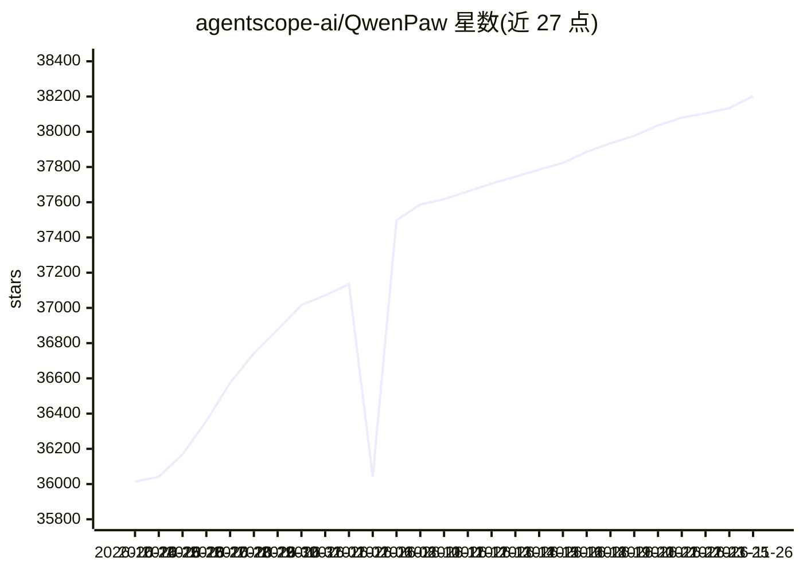

# agentscope-ai/QwenPaw

⭐ 38,202 · Python · Apache-2.0 · 推送 2026-11-25 · [GitHub](https://github.com/agentscope-ai/QwenPaw) · [官网](http://qwenpaw.agentscope.io/) · 组织维护 · 中文 README

**可自部署的个人 AI 助手：多渠道接入、可扩展技能插件**

面向个人用户的 AI 助手框架，可部署在本地或云端。核心机制包括三层记忆（工作上下文、完整历史、自演化知识库）、内核级沙箱与工具/文件防护、多 Agent 并行与 ACP 跨系统编排、文件工作区，以及通过 Skills、插件市场与 MCP 进行的能力扩展。支持钉钉、飞书、微信、Discord、Telegram、iMessage、QQ 等渠道接入，提供 Console、TUI 与桌面应用。内置 QwenPaw Local 运行时可免 API key 运行，也可连接 Ollama、LM Studio 或 14+ 云服务商。桌面应用处于 Beta 阶段。

## 筛选速览

| 维度 | 判定 | 备注 |
|---|---|---|
| AI 角色 | `ai-native` | 本体是模型或模型工具 |
| 许可风险 | `permissive` | Apache-2.0 |
| 部署形态 | `desktop` | 安装包/桌面程序 |
| 模型依赖 | local-ok | 支持本地模型 |
| 硬件要求 | — | 无带数字的原话,不猜 |
| 安装摩擦 | `low` | 无编译、无系统依赖或容器化 |
| 成熟度 | — | 结构信号不足 |

## 动量与使用信号

- 维护:`active` — 距上次 push 2.0 天,年发版 100,246 位贡献者
- 涨星:近 1 天 **+60**(自 20261016 起算)
- 安装:pypi 包 `qwenpaw` 月下载 15,362
- 平台:— · 协议:MCP / OLLAMA

## 能力要点

- 内置 QwenPaw-Flash（2B~35B-A3B）本地运行时，免 API key 运行
- 三层记忆体系：上下文、逐字历史与自演化 Markdown 知识库（ReMe）
- Kernel 级 Sandbox、Tool Guard、File Guard、Skill Scanner 安全机制
- 单实例接入钉钉/飞书/微信/Discord/Telegram/iMessage/QQ 多渠道

## 适用场景

- 定时生成新闻摘要、报告并多渠道推送
- 读写审测项目代码与处理 PDF/Word/Excel/PPT 文档
- 本地部署个人助手，数据留在自己机器上
- 将内置能力、插件与定时任务组合成自定义工作流

## 场景标签

`AI 助手` `聊天机器人` `多智能体` · 领域:Agent 开发

## 证据(README 行号)

> L26: Your personal AI assistant — deploy locally or in the cloud, extend with Skills & Plugins, connect across every cha
> L31: |**Local or cloud, runs free**|QwenPaw-Flash models (2B / 4B / 9B / 35B-A3B / 27B) trained for agent tasks. Built-i
> L36: |**Reachable anywhere**|DingTalk, Lark, WeChat, Discord, Telegram, iMessage, QQ — one instance, all channels. Conso

## 星数曲线

2026-10-24 36,014 → 2026-11-26 38,202（+2,188）

---
*卡片 v1 · prompt 1.4 · 生成 2026-11-22 · 置信度 high · 依据 README sha `8db98a0d6014` · [字段定义](../../DATASET.md)*
