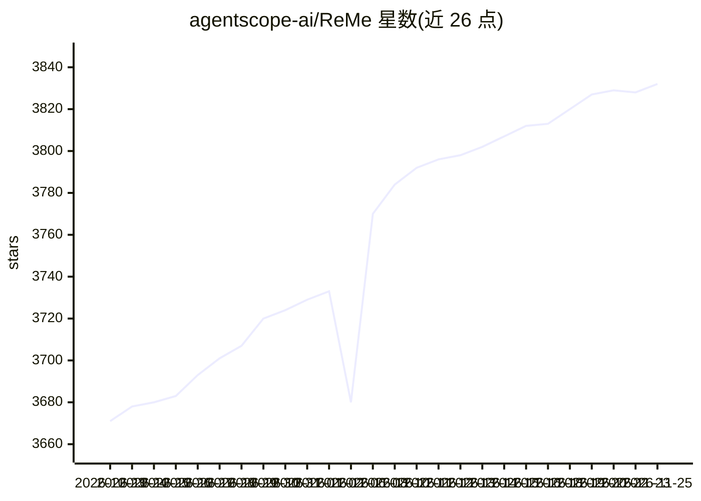

# agentscope-ai/ReMe

⭐ 3,832 · Python · Apache-2.0 · 推送 2026-11-23 · [GitHub](https://github.com/agentscope-ai/ReMe) · [官网](https://reme.agentscope.io/) · 组织维护 · 中文 README

**给 AI agent 提供本地文件化长期记忆的管理套件**

ReMe 将 agent 的对话与外部资源逐步提炼为可读写、可搜索、互链的 Markdown 记忆文件，用户可直接编辑和备份。提供捕获→索引→巩固→召回的生命周期（auto_memory、auto_index、auto_dream、proactive_read 等），检索默认用 BM25 与 wikilink 扩展，嵌入检索为可选并需配置 API key。通过 CLI、HTTP、MCP、Python API 或 SKILL.md 与 DeepSeek Harness、OpenClaw、Claude Code、QwenPaw 等 agent 运行时集成；要求 Python 3.11+，提供 pip、源码与 Docker 安装方式。

## 筛选速览

| 维度 | 判定 | 备注 |
|---|---|---|
| AI 角色 | `ai-ecosystem` | LLM/agent 周边工具 |
| 许可风险 | `permissive` | Apache-2.0 |
| 部署形态 | `self-host` | docker 或自建部署 |
| 模型依赖 | — | README 未给出锁定关系 |
| 硬件要求 | — | 无带数字的原话,不猜 |
| 安装摩擦 | `low` | 无编译、无系统依赖或容器化 |
| 成熟度 | — | 结构信号不足 |

## 能力要点

- 记忆以带 frontmatter 与 wikilink 的普通 Markdown 文件存储，索引可重建
- BM25 与 wikilink 检索，嵌入检索可选且默认关闭
- auto_memory/auto_resource/auto_index/auto_dream 构成记忆生命周期
- 通过插件或 SKILL.md 与多个 agent 运行时共享同一本地工作区

## 适用场景

- 让个人助手与编码 agent 共享同一份长期记忆工作区
- 把对话与资料自动整理成每日笔记与长期知识
- 按事件或 cron 调度任务并记录结果与提醒

## 场景标签

`Agent 记忆` · 领域:Agent 开发

## 证据(README 行号)

> L16:  A local-first, self-evolving personal knowledge base for AI agents.
> L24: 🧠 ReMe turns conversations and resources into readable, editable, searchable, and interconnected Markdown memory. A
> L202: ReMe can run as a local memory service accessed through the CLI, HTTP API, or MCP server, or it can be embedded in

## 星数曲线

2026-10-23 3,671 → 2026-11-25 3,832（+161）

---
*卡片 v1 · prompt 1.4 · 生成 2026-11-25 · 置信度 high · 依据 README sha `f7a3186e3cff` · [字段定义](../../DATASET.md)*
