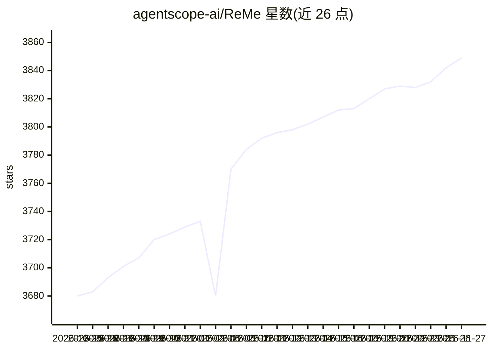

# agentscope-ai/ReMe

⭐ 3,849 · Python · Apache-2.0 · 推送 2026-11-26 · [GitHub](https://github.com/agentscope-ai/ReMe) · [官网](https://reme.agentscope.io/) · 组织维护

**面向 AI agent 的本地优先自演化 Markdown 记忆管理工具包**

将 agent 的对话与资源转化为可读、可编辑、可检索的 Markdown 记忆文件（frontmatter + wikilink），按 capture → index → consolidate → recall 生命周期演化知识。检索默认 BM25、可选嵌入、wikilink 扩展，基本文件操作与 BM25 搜索无需 LLM 凭据。通过 CLI、HTTP、MCP、Python API 或各 runtime 的插件接入 DeepSeek Harness、OpenClaw、Claude Code、Codex 等多种 agent，并提供 Proactive Runtime 按事件或 cron 调度任务。安装需 Python 3.11+，提供 pip、源码与 Docker 方式。

## 筛选速览

| 维度 | 判定 | 备注 |
|---|---|---|
| AI 角色 | `ai-ecosystem` | LLM/agent 周边工具 |
| 许可风险 | `permissive` | Apache-2.0 |
| 部署形态 | `self-host` | docker 或自建部署 |
| 模型依赖 | — | README 未给出锁定关系 |
| 硬件要求 | — | 无带数字的原话,不猜 |
| 安装摩擦 | `low` | 无编译、无系统依赖或容器化 |
| 成熟度 | — | 结构信号不足 |

## 能力要点

- 记忆以普通 Markdown 文件存储，索引与元数据可重建
- BM25 + 可选嵌入 + wikilink 扩展的行级检索
- 同一记忆工作区可被多个 agent 共享（插件/SKILL.md/CLI/HTTP/MCP/Python API）
- Proactive Runtime 支持事件触发与 cron 触发的任务调度

## 适用场景

- 为个人助理或编码 agent 提供跨 runtime 共享的长期记忆
- 把对话与文档逐步整理成可维护的知识库
- 按日程或事件自动跟进任务并提醒结果

## 场景标签

`Agent 记忆` · 领域:Agent 开发

## 证据(README 行号)

> L16:  A local-first, self-evolving personal knowledge base for AI agents.
> L38:  the same local workspace through native integrations, SKILL.md, CLI, HTTP, MCP, or Python APIs.
> L207: ReMe can run as a local memory service accessed through the CLI, HTTP API, or MCP server, or it can be embedded in

## 星数曲线

2026-10-25 3,680 → 2026-11-27 3,849（+169）

---
*卡片 v1 · prompt 1.4 · 生成 2026-11-27 · 置信度 high · 依据 README sha `5cbfd1f5503d` · [字段定义](../../DATASET.md)*
