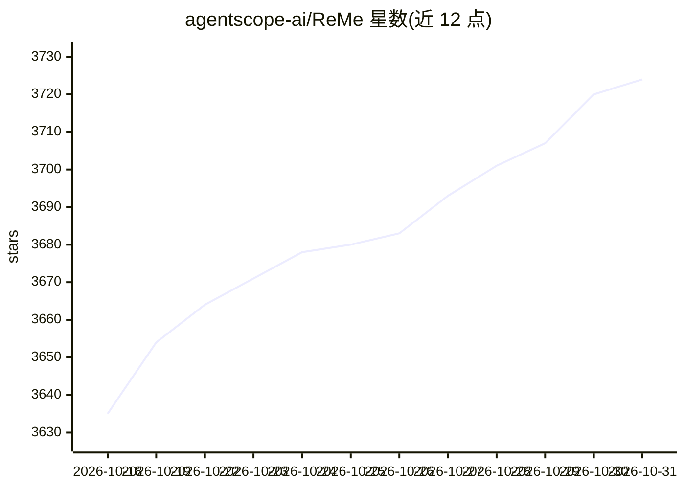

# agentscope-ai/ReMe

⭐ 3,724 · Python · Apache-2.0 · 推送 2026-10-30 · [GitHub](https://github.com/agentscope-ai/ReMe) · [官网](https://reme.agentscope.io/) · 组织维护 · 中文 README

**面向 AI agent 的本地优先记忆管理工具包**

ReMe 将对话与外部资源逐步转化为可读、可编辑的 Markdown 记忆文件（含 frontmatter 与 wikilinks），按 capture→index→consolidate→recall 循环运行，支持 auto_memory/auto_resource/auto_index/auto_dream/proactive_read 等能力。检索采用 BM25 加可选向量（RRF 融合），默认无需嵌入模型或 LLM API key。可通过 CLI、HTTP、MCP、Python API 供多个 agent 共享同一本地记忆工作区，并为 DeepSeek Harness、OpenClaw、QwenPaw、Claude Code、Hermes、Codex 等提供集成；要求 Python 3.11+。

## 筛选速览

| 维度 | 判定 | 备注 |
|---|---|---|
| AI 角色 | `ai-ecosystem` | LLM/agent 周边工具 |
| 许可风险 | `permissive` | Apache-2.0 |
| 部署形态 | `self-host` | docker 或自建部署 |
| 模型依赖 | — | README 未给出锁定关系 |
| 硬件要求 | — | 无带数字的原话,不猜 |
| 安装摩擦 | `low` | 无编译、无系统依赖或容器化 |
| 成熟度 | — | 结构信号不足 |

## 能力要点

- 记忆以普通 Markdown 文件存储，索引与元数据可重建
- BM25 + 可选向量检索经 RRF 融合，返回行级片段与 wikilink 邻居
- 为 6+ 种 agent 运行时提供原生插件或 MCP/HTTP/CLI 集成
- 基础文件操作、BM25 搜索与 wikilink 遍历无需 LLM 凭证

## 适用场景

- 让个人助手与编码 agent 共享同一份本地长期记忆
- 把聊天记录和本地资源沉淀为可编辑的知识库
- 为 agent 增加 recall、自动记忆与定期整理能力

## 场景标签

`Agent 记忆` · 领域:Agent 开发

## 证据(README 行号)

> L16:  A local-first, self-evolving personal knowledge base for AI agents.
> L200: ReMe can run as a local memory service accessed through the CLI, HTTP API, or MCP server, or it can be embedded in
> L252: ReMe follows a capture → index → consolidate → recall loop. Workspace files remain the durable source of truth;

## 星数曲线

2026-10-18 3,635 → 2026-10-31 3,724（+89）

---
*卡片 v1 · prompt 1.4 · 生成 2026-10-21 · 置信度 high · 依据 README sha `72a35e857c2c` · [字段定义](../../DATASET.md)*
