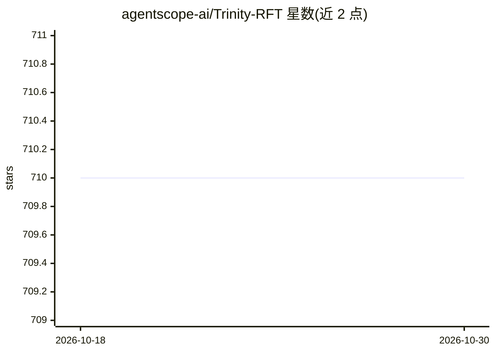

# agentscope-ai/Trinity-RFT

⭐ 710 · Python · Apache-2.0 · 推送 2026-10-08 · [GitHub](https://github.com/agentscope-ai/Trinity-RFT) · [官网](https://agentscope-ai.github.io/Trinity-RFT/) · 组织维护 · 中文 README

**面向开发与研究的 LLM 强化微调通用框架**

Trinity-RFT 是一个 LLM 强化微调（RFT）框架，将 RFT 解耦为 Explorer（生成经验数据）、Trainer（更新模型权重）与 Buffer（数据管道处理）三个协同组件。支持同步/异步、on-policy/off-policy、online/offline 多种 RL 模式与多步 agentic 工作流训练，内置 PPO、GRPO、DAPO、SFT、DPO 等 20 余种算法配置。面向 agent 应用开发者、RL 研究者与数据工程师；无 GPU 用户可经 Tinker 后端在 CPU 上运行，GPU 路径要求 CUDA>=12.8 与算力 8.0+ 的 NVIDIA GPU，提供 Docker/PyPI/源码多种安装方式。

## 筛选速览

| 维度 | 判定 | 备注 |
|---|---|---|
| AI 角色 | `ai-ecosystem` | LLM/agent 周边工具 |
| 许可风险 | `permissive` | Apache-2.0 |
| 部署形态 | `self-host` | docker 或自建部署 |
| 模型依赖 | — | README 未给出锁定关系 |
| 硬件要求 | `cpu-ok` | |
| 安装摩擦 | `low` | 无编译、无系统依赖或容器化 |
| 成熟度 | `idea` | |

## 能力要点

- Explorer/Trainer/Buffer 三组件解耦架构，rollout 与训练可独立扩展
- 支持 PPO/GRPO/DAPO/DPO/SFT 等 20 余种算法与多模态模型
- Tinker 后端支持无 GPU 的 CPU-only 快速上手
- 多步 agentic RL 工作流与全生命周期数据管道（清洗/增强/人机协同）

## 适用场景

- 训练特定领域的 LLM agent（如 web-search agent）
- 设计并验证新的 RL 微调算法
- 构建 RFT 数据集与在线任务课程数据管道
- 无本地 GPU 时通过 Tinker 后端做 RFT 实验

## 场景标签

`微调` `强化学习` · 领域:训练与推理

## 证据(README 行号)

> L14: Trinity-RFT is a general-purpose, flexible and user-friendly framework for LLM reinforcement fine-tuning (RFT).
> L18: * **Trainer** updates model weights by minimizing losses on the data;

## 星数曲线

2026-10-18 710 → 2026-10-30 710（+0）

---
*卡片 v1 · prompt 1.4 · 生成 2026-10-22 · 置信度 high · 依据 README sha `15c69ba1a443` · [字段定义](../../DATASET.md)*
