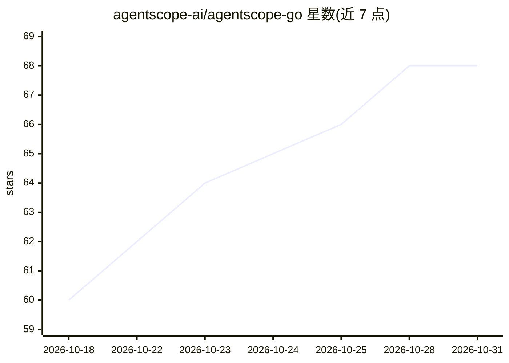

# agentscope-ai/agentscope-go

⭐ 68 · Go · Apache-2.0 · 推送 2026-10-30 · [GitHub](https://github.com/agentscope-ai/agentscope-go) · 组织维护 · 中文 README

**Go 语言多智能体应用构建框架，面向 LLM agent 开发**

AgentScope 的 Go 实现，以 Go 接口、contexts 与 channels 实现 agent 核心概念，可嵌入服务或命令行程序。支持工具调用与人工确认、多智能体流水线与 leader/worker 团队、检索与记忆中间件、HTTP 服务与浏览器 UI、追踪与评测。提供 OpenAI、Anthropic、DashScope、DeepSeek、Gemini、Moonshot、xAI、Ollama 等适配器，附 60 余个示例。需 Go 1.25+；部分包为实验性接口，权限检查不提供完整进程隔离。

## 筛选速览

| 维度 | 判定 | 备注 |
|---|---|---|
| AI 角色 | `ai-ecosystem` | LLM/agent 周边工具 |
| 许可风险 | `permissive` | Apache-2.0 |
| 部署形态 | `None` |  |
| 模型依赖 | local-ok | 支持本地模型 |
| 硬件要求 | — | 无带数字的原话,不猜 |
| 安装摩擦 | `low` | 无编译、无系统依赖或容器化 |
| 成熟度 | `idea` | |

## 能力要点

- 以 Go 接口实现 AgentScope 核心概念，可嵌入服务或 CLI
- 8 家模型提供方适配器（含 Ollama 本地模型）
- 60+ 示例覆盖工具调用、多智能体、RAG、评测、边缘部署等
- MCP 工具发现、A2A 通信、追踪与负载测试支持

## 适用场景

- 在 Go 服务中构建带工具调用与人工确认的助手
- 编排多智能体流水线或 leader/worker 团队
- 构建带记忆与检索的应用并评测运行记录
- 在边缘/本地环境用 Ollama 路由模型调用

## 场景标签

`Agent 框架` `多智能体` · 领域:Agent 开发

## 证据(README 行号)

> L11: AgentScope Go is a Go library for building LLM applications with agents, tools
> L21: - **Multi-agent workflows:** coordinate agents with pipelines, message routing

## 星数曲线

2026-10-18 60 → 2026-10-31 68（+8）

---
*卡片 v1 · prompt 1.4 · 生成 2026-10-24 · 置信度 high · 依据 README sha `2ea47927957c` · [字段定义](../../DATASET.md)*
